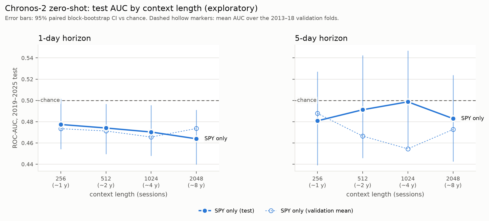
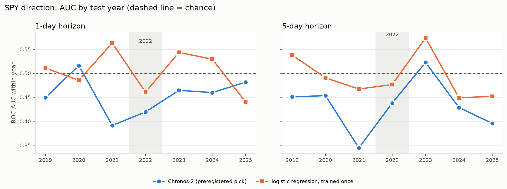
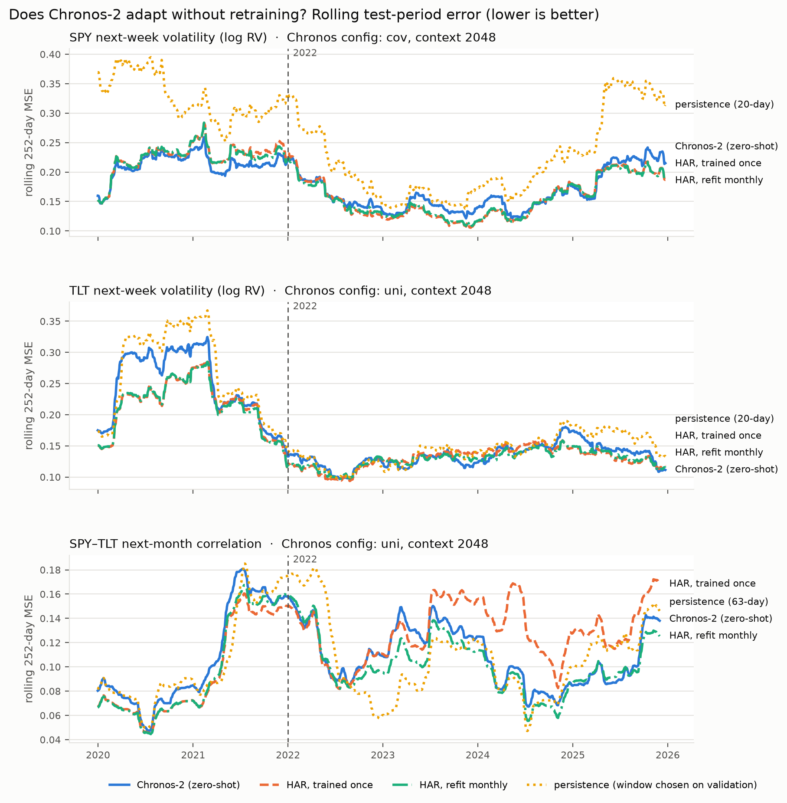

# Chronos-2: foundation-model forecasts for SPY direction, volatility and correlation

This folder answers the project's **research question 2**: *do pretrained time-series foundation models beat task-specific models, and can they handle drift without retraining?* It uses **Chronos-2** (`amazon/chronos-2`, 120M parameters) **zero-shot**: the model is never trained or fine-tuned on our data, and only re-reads recent history at each forecast.

Every experiment reuses the project's evaluation framework:

* the same data, labels, test days and purging rule;
* walk-forward validation folds F1 = 2013–14, F2 = 2015–16 and VAL = 2017–18;
* a frozen choice (SHA-256) before a single run on **2019–2025**;
* the same paired moving-block bootstrap and Holm correction.

## Bottom line

| question | answer |
|---|---|
| Does Chronos-2 predict SPY's **direction** (1-day, 5-day)? | **No.** Test AUC 0.477 / 0.479, slightly below chance, not better than a trained-once logistic regression (all Holm p = 1). Its probabilities are worse calibrated than the base rate. |
| Does it forecast **volatility** well? | **Yes, but not better than HAR.** It beats persistence by 32% in MSE for SPY (Holm p < 0.001), but is 3–7% worse than a simple HAR regression trained once (not significant). |
| Can it **handle drift without retraining**? | **Partly.** After the 2022 stock–bond correlation flip, Chronos avoided the failures of the trained-once HAR (6.5% lower MSE, not significant). A HAR **refit monthly** still adapted better (Chronos 9.6% worse, significant), and nothing beat 63-day persistence. |
| Does more context (history) help? | **For volatility and correlation, yes:** 2048 sessions was best on every target. **For direction, no:** at h = 1, longer context was slightly *worse*. Chronos does not adapt better by looking at less history. |
| Did 2022 break Chronos's direction forecasts? | **No.** Its worst direction years were 2019–21, before the regime change. |

## Files

| file | contents |
|---|---|
| `chronos_study.py` | **Direction study:** `smoke`, `validate`, `select`, `test`, `explore` |
| `chronos_vol_corr_drift.py` | **Volatility / correlation study** (`smoke`, `validate`, `select`, `test`) and the **direction drift breakdown** (`direction-drift`). Imports `chronos_study.py` and the teammates' `experiments/v2_lib.py`. |
| `chronos_preregistration.md` | preregistration of the direction study (written before its test) |
| `results/` | direction study: validation log, selection table, frozen choice (`chronos_shortlist.json` + `.sha256`), test levels / comparisons / by-year, exploratory context-length table and figure, cached predictions |
| `results_ext/` | volatility / correlation study: validation log, selection table, frozen choice (`ext_shortlist.json` + `.sha256`), test levels / comparisons / sub-periods / by-year / rolling MSE, figures, and the direction drift tables, cached predictions |

---

## Part A. SPY direction

### A1. How a forecast becomes a direction prediction

The label is the project's: at the close of day t, **up if Close[t+h] > Open[t+1]**.

* g[t] = log(Close[t] / Open[t−h+1]) is known at the close of t.
* g[t+h] = log(Close[t+h] / Open[t+1]) is exactly the label's forward log return. The script asserts this for every row.
* Chronos receives g (and any covariates) **up to the close of t**, forecasts h steps ahead, and returns 21 quantiles.
* **P(up) = 1 − F(0)** from the step-h quantiles.
* Threshold: base rate of labels known at the period start, the same rule as the trained-once models.

### A2. Candidates and selection

| variant | inputs |
|---|---|
| `uni` | SPY's g series only |
| `joint` | g series of SPY, QQQ, IWM, TLT, GLD forecast **jointly**, plus log VIX as a past covariate |
| `core` | SPY's g series with the project's 23 `CORE_FEATURES` as past covariates |

× context length 256 / 512 / 1024 / 2048 sessions (about 1, 2, 4 and 8 years) = **12 configurations per horizon**. Chronos has no training window, so context length is its analogue of the fixed / expanding / rolling choice.

**Selection rule**, fixed in code before validation:

1. Eligible if BA > 0.5 **and** AUC > 0.5 in ≥ 2 of 3 folds, **and** AUC > 0.5 on VAL. The VAL condition was added because the earlier audit found that "2 of 3" alone let 2013–16 outvote the fold most like the test.
2. Rank by mean (BA − 0.5) + (AUC − 0.5).
3. If none is eligible, take the best and mark it ineligible.

**No configuration was eligible at either horizon.** Almost every validation AUC was at or below 0.5, down to 0.38 in 2013–16 at h = 5 with long contexts. The trained-once logistic regression was anti-predictive in the same years.

| h | chosen (fallback) | val mean ΔBA / ΔAUC | Platt calibration fitted on VAL |
|---|---|---|---|
| 1 | `joint`, context 512 | −0.0005 / −0.0087 | slope 0.32: probabilities shrunk by about two thirds |
| 5 | `core`, context 256 | +0.0024 / −0.0094 | slope **−0.09**: reverses the ranking |

Frozen in `results/chronos_shortlist.json` (SHA-256 `336ce5ed…7b6e`) and documented in `chronos_preregistration.md` before the test.

### A3. Test results (2019-01-02 to 2025, run once)

| h | model | BA | AUC | Brier |
|---|---|---|---|---|
| 1 | **Chronos-2** | 0.484 | 0.477 | 0.251 |
| 1 | chance | 0.500 | 0.500 | 0.248 |
| 1 | logistic regression, trained once | 0.500 | 0.500 | 0.272 |
| 5 | **Chronos-2** | 0.500 | 0.479 | 0.261 |
| 5 | chance | 0.500 | 0.500 | 0.238 |
| 5 | logistic regression, trained once | 0.514 | 0.520 | 0.240 |

| h | comparison | Δ AUC [95% CI] | Δ Brier [95% CI] | Holm p (BA / AUC) |
|---|---|---|---|---|
| 1 | Chronos vs chance | −0.024 [−0.051, +0.003] | **−0.003 [−0.005, −0.001]** | 1.0 / 1.0 |
| 1 | Chronos vs LogReg | −0.023 [−0.065, +0.016] | **+0.021 [+0.012, +0.032]** | 1.0 / 1.0 |
| 5 | Chronos vs chance | −0.021 [−0.060, +0.023] | **−0.024 [−0.032, −0.014]** | 1.0 / 1.0 |
| 5 | Chronos vs LogReg | −0.042 [−0.094, +0.003] | **−0.022 [−0.030, −0.013]** | 1.0 / 1.0 |

Δ = Chronos − comparator, so positive means Chronos is better; for Brier the sign is flipped. Bold marks CIs that exclude zero.

* **Confirmed wins: 0 of 4.**
* Chronos's probabilities are significantly worse than the base rate in Brier terms. At h = 1 it beats the LogReg on Brier only because that LogReg is even worse calibrated.
* The calibrated h = 5 forecast (AUC 0.521) is not a real gain: it is the reversed ranking (1 − 0.479), it predicts "up" 99.6% of the time, and it is not significant.

### A4. Context length on the test period (exploratory, `uni` variant)



| h | 256 | 512 | 1024 | 2048 |
|---|---|---|---|---|
| 1 (test AUC) | 0.477 | 0.474 | 0.470 | **0.464** |
| 5 (test AUC) | 0.481 | 0.491 | 0.499 | 0.483 |

At h = 1, AUC falls steadily as context grows, and the CIs exclude 0.5 for 512 sessions and longer. At h = 5, every context is within noise of chance. These results were run after the confirmatory test and are not preregistered.

### A5. Direction by sub-period (descriptive, `direction-drift`)



| h | period | Chronos AUC | LogReg AUC | Chronos − chance [95% CI] |
|---|---|---|---|---|
| 1 | 2019–21 | 0.457 | 0.516 | −0.043 [−0.087, −0.000] |
| 1 | 2022–25 | 0.477 | 0.488 | −0.023 [−0.057, +0.017] |
| 5 | 2019–21 | 0.421 | 0.503 | **−0.079 [−0.136, −0.011]** |
| 5 | 2022–25 | 0.505 | 0.528 | +0.005 [−0.044, +0.058] |

Chronos's worst stretch was **2019–21, before the 2022 regime change**. After 2022 it was at chance, so for direction there was no regime-related breakdown to adapt to. The table holds 12 uncorrected comparisons, so read the 2019–21 result as a pattern, not a finding. Chronos's within-year AUC was below 0.5 in 6 of 7 years at both horizons.

---

## Part B. Volatility and correlation targets

The proposal's fallback targets "with clearer regime shifts" were already studied by the teammates (`experiments/v2_*`): monthly refitting helped the stock–bond correlation forecast after its 2022 flip. Part B asks whether Chronos-2 can achieve the same **without retraining**.

### B1. Setup

The targets, rows and test days are identical to the v2 study (`experiments/v2_lib.py`):

| target | h | forecast | series given to Chronos (known at t) |
|---|---|---|---|
| `spy_vol` | 5 | log annualised realised vol of SPY over t+1..t+5 | trailing 5-day log RV; its value at t+5 is the target |
| `tlt_vol` | 5 | same for TLT | same for TLT |
| `spy_tlt_corr` | 21 | realised SPY–TLT return correlation over t+1..t+21 | trailing 21-day correlation; its value at t+21 is the target |

* The step-h **forecast mean** is the prediction, and MSE is the primary metric.
* Variants:
  * `uni`: the series alone.
  * `cov`: the series plus HAR-type past covariates. For volatility these are daily range vol, 22-day RV and log VIX (plus SPY's RV for TLT). For correlation they are the 63- and 252-day correlations, log VIX and both assets' 22-day RV.
  * Each variant is run at 4 context lengths, giving **8 configurations per target**.
* Comparators, recomputed with `v2_lib` and asserted identical to the teammates' saved test predictions:
  * **HAR trained once:** the v2 study's best baseline.
  * **HAR refit monthly:** the same model, expanding window, refit every 21 sessions; v2 slot `.5`.
  * **Persistence:** 20-day RV for volatility, 63-day correlation for correlation. In each case the window had the lower validation MSE.

**Selection rule**, the v2 study's, fixed in code before validation: eligible if MSE is lower than the trained-once HAR on VAL **and** on average over the 3 folds. Rank by mean MSE skill; if nothing is eligible, take the best and mark it ineligible.

**Win criterion**, the v2 study's "large, real" bar: Holm p < 0.05 vs the trained-once HAR **and** at least 5% lower MSE. Holm is applied over the 3 comparisons per target and metric.

### B2. Validation

**No configuration was eligible for any target.** Chronos clearly beat persistence on volatility but never beat the trained-once HAR on average.

| target | chosen (fallback) | mean MSE skill vs HAR trained once | VAL skill |
|---|---|---|---|
| `spy_vol` | `cov`, context 2048 | −5.7% | −3.9% |
| `tlt_vol` | `uni`, context 2048 | −2.7% | **+9.9%** (worse in 2013–16) |
| `spy_tlt_corr` | `uni`, context 2048 | −3.1% | −4.9% (better in 2015–16) |

Patterns:

* **Longer context was better on every target.** MSE fell almost monotonically from 256 to 2048 sessions.
* **Covariates matter for SPY volatility,** cutting MSE by about 20%, mostly because of VIX. They barely help TLT and hurt correlation.
* **Validation (2013–18) contained no correlation regime change,** so it could not reward adaptation. The teammates' validation had the same limitation.

Frozen in `results_ext/ext_shortlist.json` with SHA-256 recorded in `ext_shortlist.sha256` before the test. Unlike Part A, no separate preregistration document was written for this freeze.

### B3. Test results (2019–2025, run once)

| target | model | MSE | R² | bias | AUC* |
|---|---|---|---|---|---|
| `spy_vol` | **Chronos-2** | 0.1835 | 0.471 | +0.022 | 0.753 |
| | HAR trained once | 0.1775 | 0.488 | −0.001 | 0.759 |
| | HAR refit monthly | 0.1771 | 0.489 | −0.004 | 0.758 |
| | persistence (20-day) | 0.2696 | 0.223 | +0.125 | 0.500 |
| `tlt_vol` | **Chronos-2** | 0.1647 | 0.205 | +0.036 | 0.594 |
| | HAR trained once | 0.1539 | 0.257 | −0.022 | 0.640 |
| | HAR refit monthly | 0.1524 | 0.264 | −0.019 | 0.643 |
| | persistence (20-day) | 0.1776 | 0.143 | +0.091 | 0.500 |
| `spy_tlt_corr` | **Chronos-2** | 0.1116 | 0.131 | −0.089 | 0.749 |
| | HAR trained once | 0.1194 | 0.070 | −0.155 | 0.779 |
| | HAR refit monthly | **0.1018** | **0.207** | −0.087 | 0.775 |
| | persistence (63-day) | 0.1091 | 0.150 | −0.021 | 0.778 |

\*AUC of the derived classification: next-week vol above its trailing 20-day level, or next-month correlation > 0.

| target | Chronos vs | MSE change | Δ MSE [95% CI] | Holm p |
|---|---|---|---|---|
| `spy_vol` | HAR trained once | −3.4% | −0.0061 [−0.0160, +0.0059] | 1.0 |
| | HAR refit monthly | −3.6% | −0.0064 [−0.0157, +0.0050] | 1.0 |
| | persistence | **+31.9%** | **+0.0861 [+0.0570, +0.1156]** | **< 0.001** |
| `tlt_vol` | HAR trained once | −7.0% | −0.0108 [−0.0272, +0.0030] | 1.0 |
| | HAR refit monthly | −8.1% | −0.0123 [−0.0277, +0.0002] | 1.0 |
| | persistence | +7.3% | +0.0129 [−0.0060, +0.0347] | 0.30 |
| `spy_tlt_corr` | HAR trained once | **+6.5%** | +0.0078 [−0.0078, +0.0230] | 0.55 |
| | HAR refit monthly | −9.6% | **−0.0097 [−0.0168, −0.0025]** | 1.0 |
| | persistence | −2.3% | −0.0025 [−0.0225, +0.0160] | 1.0 |

Positive = Chronos better; "MSE change" is the relative reduction versus the comparator. Holm p tests "Chronos better", so a significantly *worse* result shows as a CI below zero with Holm p = 1.

**Large, real wins: 0 of 3.**

### B4. Drift: does Chronos adapt without retraining?



| target | Chronos vs | 2019–21 Δ MSE [95% CI] | 2022–25 Δ MSE [95% CI] |
|---|---|---|---|
| `spy_tlt_corr` | HAR trained once | **−0.0111 [−0.0187, −0.0034]** | +0.0224 [−0.0030, +0.0472] (p = 0.051) |
| `spy_tlt_corr` | HAR refit monthly | −0.0084 [−0.0167, +0.0005] | **−0.0108 [−0.0213, −0.0009]** |
| `spy_vol` | HAR trained once | +0.0057 [−0.0068, +0.0254] | −0.0150 [−0.0290, +0.0003] |
| `tlt_vol` | HAR trained once | **−0.0249 [−0.0556, −0.0023]** | −0.0000 [−0.0164, +0.0158] |

* **Correlation.** Before the flip (2019–21), Chronos was significantly worse than the trained-once HAR. After it (2022–25), the roles reverse:
  * The trained-once HAR's error spikes in mid-2023, in 2024 and in late 2025, because it still expects the pre-2022 negative correlation.
  * Chronos's error tracks the monthly-refit HAR through all three episodes.
  * Chronos's bias (−0.089) equals the refit model's (−0.087), against −0.155 for the trained-once HAR. Re-reading recent history is enough to remove the stale bias **without retraining**.
  * The refit HAR is still about 10% better, because it ranks months better (AUC 0.775 vs 0.749).
* **Volatility.** There was no persistent regime shift to adapt to, as the v2 study also found. Chronos tracks HAR closely throughout and is slightly worse. Its one bad stretch is TLT volatility in 2020–21.

---

## Pretraining overlap

The proposal promised to check whether the foundation model's pretraining data overlaps our test period.

* **What the paper says.** The Chronos-2 paper (arXiv:2510.15821, October 2025) describes pretraining on select datasets from the Chronos and GIFT-Eval pretraining corpora, plus synthetic data. Its multivariate and covariate abilities were learned **entirely from synthetic data**. The paper does not mention stock or ETF prices among its training data and states no data cutoff. We could not check its full per-dataset list, so overlap with 2019–2025 cannot be ruled out entirely.
* **What the results say.** Overlap would be expected to *flatter* Chronos, yet:
  * on direction it is slightly below chance;
  * on volatility it is worse than a simple HAR;
  * its one relative success, adapting to the 2022 correlation flip, is matched by refitting a linear model.

  None of the conclusions depends on the pretraining corpus being clean.

## Conclusions for research question 2

1. **Foundation model vs task-specific models.** Chronos-2 does not beat the task-specific models on any target:
   * **Direction:** neither Chronos nor the classical models find signal.
   * **Volatility:** Chronos is good, far better than persistence, but a two-line HAR regression is as good or better.
   * **Correlation:** a monthly-refit linear model is significantly better.
2. **Drift without retraining.** Yes, partially. On the one target with a real regime shift, Chronos avoided the stale-model failure that hurt the trained-once HAR after 2022, just by re-reading recent history. Periodic refitting of a simple model still adapted better, and no model beat 63-day persistence.
3. **Context length is not a drift lever.** More history helped Chronos on volatility and correlation, and slightly hurt it on 1-day direction. Short contexts never helped, so "adapting by looking at less history" did not work.
4. **Consistent with the rest of the project.** Chronos-2 joins logistic regression, GBDT, 206 drift-aware configurations, extra features, FRED data and ARMAX: no detectable predictable direction in SPY at 1 or 5 days.

## Limitations

* **Zero-shot only.** Fine-tuning Chronos-2, once or periodically, was not tried, and neither was TimesFM.
* **Fallback picks everywhere.** No configuration passed its selection rule, so each test measures the least-bad validated candidate.
* **Validation had no correlation regime change,** so model selection could not reward adaptation.
* **Part B's freeze is hash-recorded but has no separate preregistration document,** and its test window (2019–2025) had already been used by the v2 study.
* **Possible pretraining overlap** (see above).
* **Power.** A 7-year test detects only gains of a few points of AUC or a few percent of MSE.

## Reproducing

Run from the project root with `data/aligned_prices.pkl` in place.

```
pip install -r requirements.txt
pip install chronos-forecasting
# NVIDIA GPU: install a CUDA build of PyTorch, e.g.
#   pip install torch --index-url https://download.pytorch.org/whl/cu128

# Part A: direction
python chronos_experiment/chronos_study.py smoke
python chronos_experiment/chronos_study.py validate          # ~1 h on an RTX 3050 laptop GPU
python chronos_experiment/chronos_study.py select
python chronos_experiment/chronos_study.py test              # one-shot; refuses to run twice
python chronos_experiment/chronos_study.py explore --variants uni   # exploratory context-length figure

# Part B: volatility / correlation, and the direction drift breakdown
python chronos_experiment/chronos_vol_corr_drift.py smoke
python chronos_experiment/chronos_vol_corr_drift.py validate # ~1 h
python chronos_experiment/chronos_vol_corr_drift.py select
python chronos_experiment/chronos_vol_corr_drift.py test     # one-shot; refuses to run twice
python chronos_experiment/chronos_vol_corr_drift.py direction-drift
```

Notes:

* `--batch N`, placed before the command, sets the GPU batch size. It halves automatically on an out-of-memory error.
* Predictions are cached as `.pkl` files, so interrupted runs resume where they stopped.
* `chronos_study.py` and `chronos_vol_corr_drift.py` were written with an AI coding assistant (Claude), as the proposal requires us to disclose.

## References

* Ansari, A. F. et al. "Chronos: Learning the Language of Time Series." TMLR, 2024. arXiv:2403.07815
* Ansari, A. F. et al. "Chronos-2: From Univariate to Universal Forecasting." 2025. arXiv:2510.15821
* Corsi, F. "A Simple Approximate Long-Memory Model of Realized Volatility." Journal of Financial Econometrics 7(2), 2009 (the HAR model).
