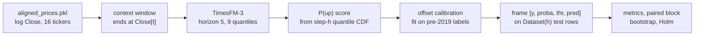
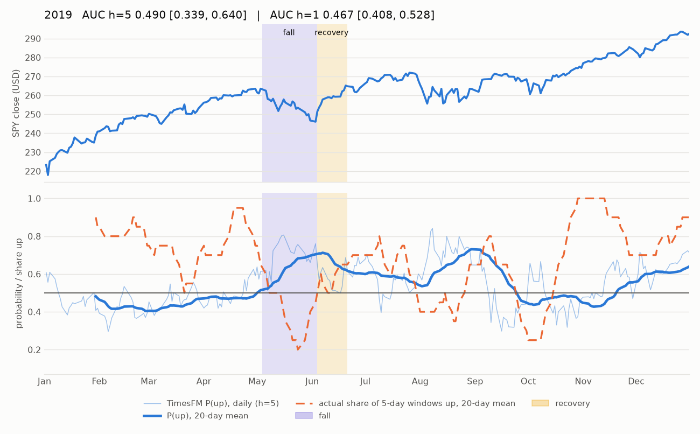
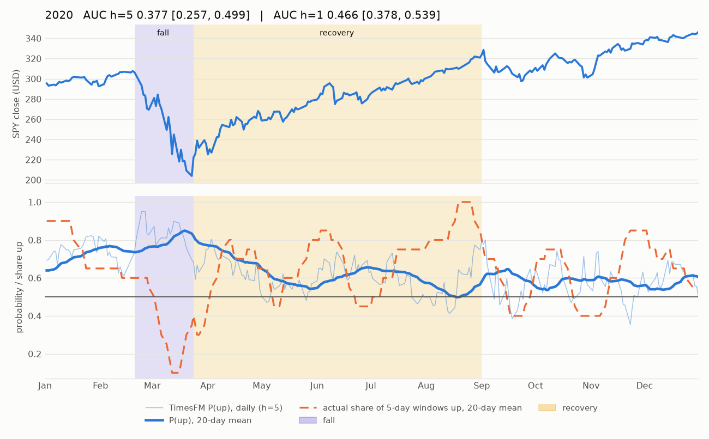
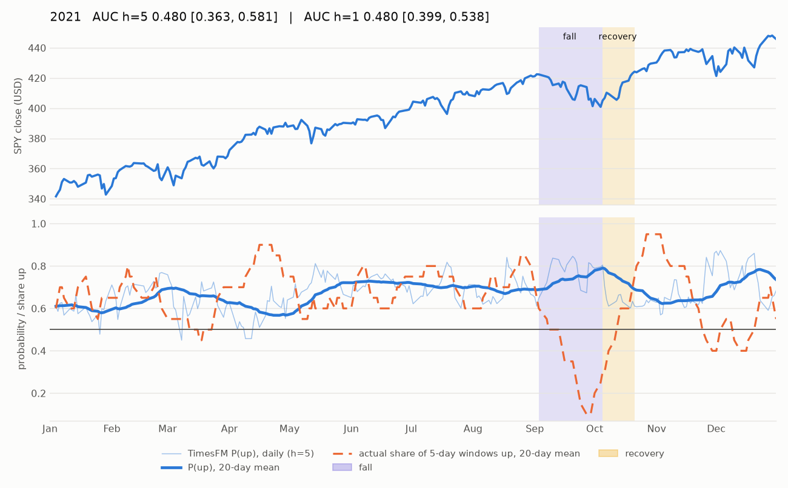
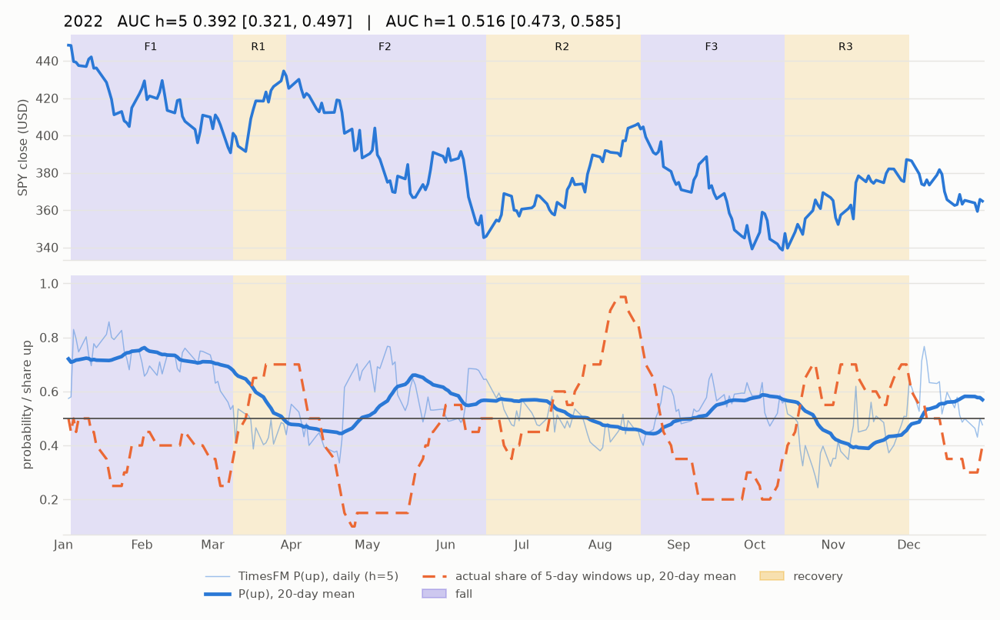
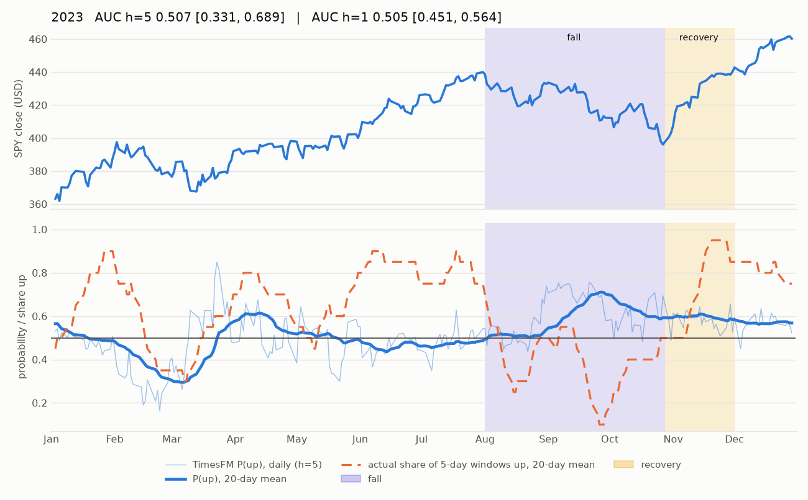
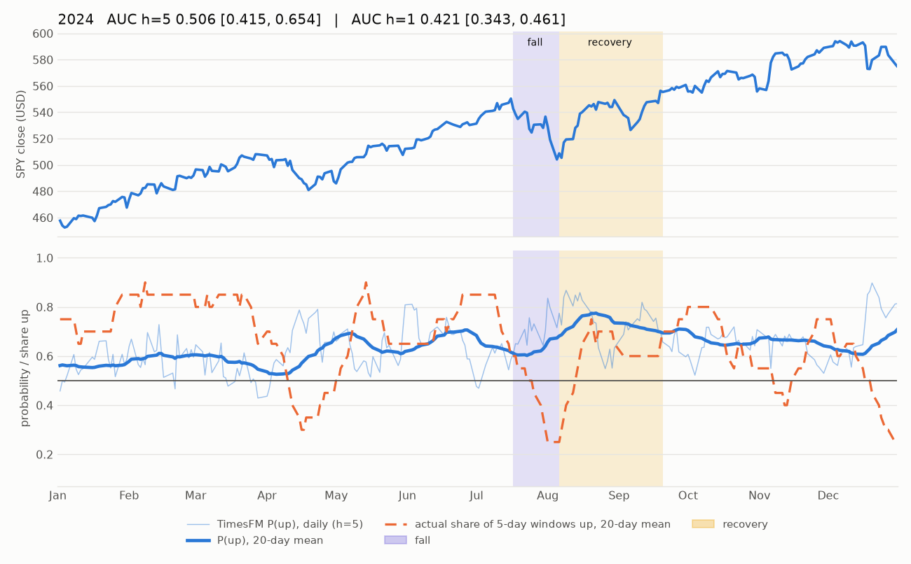
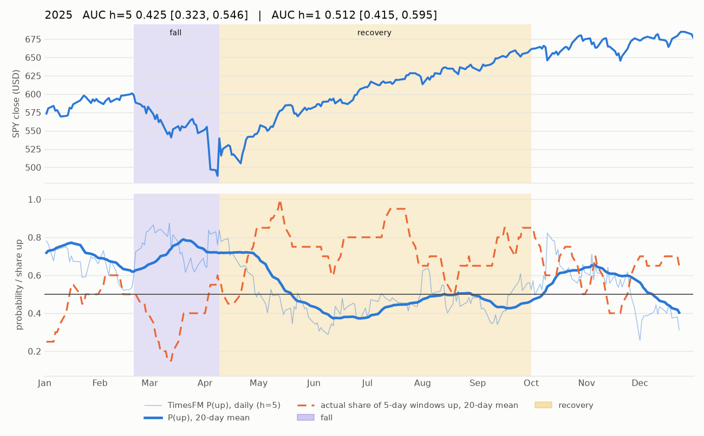

# TimesFM-3 for SPY direction

Google's TimesFM-3 is a pretrained forecasting model. Used "as is", without any training on our data, can it predict whether SPY goes up on the project's task?

**Short answer.** TimesFM-3 performs worse than the project's logistic regression model. On 2019–2025 it ranks up-days and down-days slightly *worse* than a coin flip at both horizons. At the 5-day horizon the gap to the logistic regression is clearly real; at the 1-day horizon it could still be luck.

---

## In short: why TimesFM did badly, and what SPY did each year (easy English)

**The result.** Over 2019–2025, TimesFM-3 guessed SPY's direction slightly worse than a coin flip: AUC 0.482 for tomorrow (h=1) and 0.459 for the next 5 days (h=5). AUC 0.5 is a coin flip and 1.0 is always right (see 1.1). At h=5, three years did most of the damage: 2020 (0.377), 2022 (0.392) and 2025 (0.425). These are the three years in which SPY had a big fall. In the four calm years it scored close to 0.5.

**Why, in five points:**

1. **SPY's next week is very hard to guess.** Simple rules like "it went up last month, so say up" score about 0.50. Over 2019–2025, how much SPY moved in the last 20 days tells you nothing about the next 5 days (correlation 0.00). So there is very little for any model to find.
2. **TimesFM has a habit: after a rise it expects a dip, and after a fall it expects a bounce.** The habit is strongest in rough weeks. It comes from the model's network itself, not from its detrending step (see 1.3, steps 1–4).
3. **But this habit is not what made 2020, 2022 and 2025 bad.** During a fall it said "up", which was wrong. During the recovery it still said "up", which was right. Over a year, the two evened out.
4. **Another part of its forecast sank those years.** During the 2022 and 2025 recoveries, this part pushed the forecast down on 8 out of 10 days, while the market went up in about 3 out of 4 windows. During the 2020 and 2025 falls it pushed the forecast up. In 2025, part of this comes from a built-in step that draws a straight line through the past year and continues it: during the recovery, that line pulled the forecast down. For 2020 and 2022 we could not find what this part reacts to.
5. **In the calm years it is just a coin flip.** One year is too short to tell 0.48 from 0.50 (see the yearly intervals in 1.3). That is what you expect from a model with nothing real to find. At h=1 (tomorrow's open-to-close move), every year is near 0.5 except 2024 (0.421), which we cannot explain.

**Tiny example for points 3 and 4.** Take 4 days in 2025: 2 during the fall (the market then went down) and 2 during the recovery (the market then went up).

- The habit says "up" on all 4 days: right twice, wrong twice. That is a coin flip.
- The other part says "up" on the 2 fall days and "down" on the 2 recovery days: wrong all 4 times.
- Together, they are worse than a coin flip, and the other part is the reason.

**What SPY did each year.** The SPY numbers come from `timesfm3_experiment/timesfm_explore_spy_years.py` (`timesfm3_experiment/results/timesfm_spy_years.csv`). Prices include dividends, and dates are closing days. Each year gets its own subsection in "Appendix: Each year in detail" at the end of the report.

| year | SPY over the year | biggest fall from a high | back at that high on | days that moved more than 2% | 5-day windows that went up | TimesFM AUC, h=1 | TimesFM AUC, h=5 |
|---|---|---|---|---|---|---|---|
| 2019 | +31% | −7% (May 3 – Jun 3) | Jun 20 | 7 | 68% | 0.467 | 0.490 |
| 2020 | +18% | −34% (Feb 19 – Mar 23) | Aug 10 | 43 | 63% | 0.466 | **0.377** |
| 2021 | +29% | −5% (Sep 2 – Oct 4) | Oct 20 | 8 | 63% | 0.480 | 0.480 |
| 2022 | −18% | −25% (Jan 3 – Oct 12) | not in 2022 | 46 | 46% | 0.516 | **0.392** |
| 2023 | +26% | −10% (Jul 31 – Oct 27) | Nov 30 | 2 | 62% | 0.505 | 0.507 |
| 2024 | +25% | −8% (Jul 16 – Aug 5) | Sep 19 | 7 | 64% | **0.421** | 0.506 |
| 2025 | +18% | −19% (Feb 19 – Apr 8) | Jun 26 | 14 | 64% | 0.512 | **0.425** |

**In plain words:**

- **Most years went up.** In 6 of the 7 years, 62–68% of the 5-day windows went up. That alone doesn't help AUC (see 1.1).
- **The bad years line up with the big falls.** 2020, 2022 and 2025 each fell 19% or more and had the most days with big moves (14 to 46). In the calm years (2019, 2021, 2023, 2024), the h=5 score is close to 0.5.

---

## What other studies found

**Several studies found that TimesFM does not predict stock returns or direction well when used as is.** The closest one tested TimesFM-2.5 on about 600 US stocks and found it scored below an "always up" rule at every horizon. Others found directional accuracy near 50% or no gain over a random walk. TimesFM did better on a different target (volatility), and when it was fine-tuned or pre-trained on financial data.

| paper | what they tested | what they found |
|---|---|---|
| [1] Cheung 2026 (arXiv, preprint) | TimesFM-2.5, zero-shot and LoRA fine-tuned. About 600 US stocks (NASDAQ-100 and S&P 500), 2005–2026, direction up to 128 days ahead. | "Zero-shot TimesFM is below the base rate everywhere" (Sec. 6.2): its direction accuracy was below the "always up" rule at every horizon (for example −0.024 at h=2 and −0.125 at h=128 on the S&P 500 list, Table 5). Fine-tuning cut the point error but gave no directional skill over the base rate. |
| [2] Rahimikia et al. 2025 (arXiv, preprint) | TimesFM 1 and 2, zero-shot, fine-tuned and pre-trained from scratch. Daily excess returns of firms in 94 countries, next day. | "Off-the-shelf pre-trained TSFMs perform poorly in zero-shot and fine-tuning settings" (abstract). TimesFM (500M): out-of-sample R² −2.80% and "directional accuracy just below 50%" (Sec. 1). Only models pre-trained from scratch on finance data did much better. |
| [3] Noguer i Alonso and Franklin 2026 (arXiv, preprint) | TimesFM-2.5 and others, zero-shot. Five US stocks, 20-day returns, error vs a random walk. | TimesFM-2.5 had one of the two best average ranks, but "gains over the random-walk benchmark are small and sparse" (abstract). On AAPL and JPM the random walk was more accurate than TimesFM-2.5 (Table 7). |
| [4] Goel et al. 2024 (arXiv, preprint) | TimesFM, zero-shot and fine-tuned. 19 years of daily S&P 100 returns, one-day risk estimate (Value-at-Risk). | "Fine-tuning significantly improves accuracy, showing that zero-shot use is not optimal for VaR" (abstract). The fine-tuned model was among the best methods. |
| [5] Fu et al. 2024 (arXiv, preprint) | TimesFM on financial prices; continued pre-training on about 100 million price points. | "Due to the irregular nature of price data, directly applying TimesFM gives unsatisfactory results" (abstract). The fine-tuned version did better. |
| [6] Goel et al. 2025 (arXiv, preprint) | TimesFM, zero-shot and fine-tuned. Realized volatility of the S&P 500 and stocks, one day ahead. | The balance case. Zero-shot was "a reasonable baseline", and the fine-tuned versions "statistically outperform traditional models" (abstract). |

**In plain words:**

- Two studies (1, 2) test direction directly. Both find zero-shot TimesFM no better than a simple baseline: below "always up" in study 1, and just under 50% in study 2.
- A third (3) finds no clear win over a random walk.
- The papers that report a good TimesFM (4, 5, 6) fine-tuned it first, or predicted volatility or risk instead of direction.
- Tiny example: if 70% of days in the data were up, "always say up" scores 70%. A model must beat that number, not 50%.

**How our result compares.** Our result fits this pattern. TimesFM-3 got AUC 0.482 (h=1) and 0.459 (h=5), slightly under 0.5. The setups differ. Paper 1 used accuracy against an always-up rule, not AUC, and used single stocks in a list of current members. Paper 2 used single firms, and paper 3 used error on returns. Papers 4–6 predicted risk, not direction. None of them tested TimesFM-3 or SPY direction itself, so they support our direction of result but are not a direct check. We found no paper that reports TimesFM predicting stock direction well.

**References**

1. T. Cheung. "When Directional Accuracy Lies: A Base-Rate-Honest Benchmark for LoRA-Adapted TimesFM on Equity Forecasting." arXiv:2607.12248, 2026. https://arxiv.org/abs/2607.12248
2. E. Rahimikia, H. Ni, W. Wang. "Re(Visiting) Time Series Foundation Models in Finance." arXiv:2511.18578, 2025. https://arxiv.org/abs/2511.18578
3. M. Noguer i Alonso, R. P. Franklin. "Pretrained Time-Series Foundation Models for Financial Return Forecasting." arXiv:2606.27100, 2026. https://arxiv.org/abs/2606.27100
4. A. Goel, P. Pasricha, J. Kanniainen. "Time-Series Foundation Model for Value-at-Risk." arXiv:2410.11773, 2024. https://arxiv.org/abs/2410.11773
5. X. Fu, M. Hirano, K. Imajo. "Financial Fine-tuning a Large Time Series Model." arXiv:2412.09880, 2024. https://arxiv.org/abs/2412.09880
6. A. Goel, P. Pasricha, M. Magris, J. Kanniainen. "Foundation Time-Series AI Model for Realized Volatility Forecasting." arXiv:2505.11163, 2025. https://arxiv.org/abs/2505.11163

All six are arXiv preprints; none is confirmed peer-reviewed.

---

## 1. Results

### 1.1 How to read the numbers

- **h** is how far ahead we predict, in trading days. We decide at the close of day *t*.
  - **h=1** asks: will tomorrow's close be above tomorrow's open? (`Close[t+1] > Open[t+1]`)
  - **h=5** asks: will the close 5 trading days from now be above tomorrow's open? (`Close[t+5] > Open[t+1]`)
- **ROC-AUC (AUC)** is the main score. Pick one up-day and one down-day at random. AUC is how often the model gives the up-day the higher probability. 0.5 means it can't tell them apart, 1.0 means it always gets the order right, and below 0.5 means it gets the order wrong more often than right.
- **Balanced accuracy (BA)** is the average of two hit rates: the ratio of up-days called "up" and the ratio of down-days called "down". A model that always says "up" gets 100% and 0%, so its BA is exactly 0.5.
- **Brier score** is the average squared gap between the predicted probability and what happened (1 for up, 0 for down). Lower is better.
- **chance** is the do-nothing baseline: every day gets the same probability, the historical up-rate, and is called "up".
- **fixed LR** is the project's headline model: a logistic regression on 23 features, trained once on data up to the end of 2018.

### 1.2 Headline: the 2019–2025 test

| h | model | AUC | BA | Brier | accuracy | share of days called "up" | days |
|---|---|---|---|---|---|---|---|
| 1 | **TimesFM-3** | **0.482** | **0.483** | 0.2589 | 0.482 | 0.487 | 1,759 |
| 1 | fixed LR | 0.508 | 0.514 | 0.2491 | 0.491 | 0.253 | 1,759 |
| 1 | chance | 0.500 | 0.500 | 0.2480 | 0.546 | 1.000 | 1,759 |
| 5 | **TimesFM-3** | **0.459** | **0.467** | 0.2612 | 0.478 | 0.543 | 1,755 |
| 5 | fixed LR | 0.536 | 0.536 | 0.2390 | 0.531 | 0.483 | 1,755 |
| 5 | chance | 0.500 | 0.500 | 0.2380 | 0.614 | 1.000 | 1,755 |

**In plain words:**

- **TimesFM-3 is below the coin-flip line at both horizons.** Out of 100 random (up-day, down-day) pairs, it puts the up-day first in about 48 pairs at h=1 and about 46 at h=5. The fixed LR does it in about 51 and 54.
- **Don't read the accuracy column on its own.** SPY went up in 61.4% of the 5-day windows, so "always say up" already scores 0.614 accuracy without knowing anything. That is why we judge models on AUC and BA, where "always say up" scores exactly 0.5.
- **TimesFM's probabilities are also badly sized.** Its Brier score is worse than chance at both horizons. Its probabilities move further away from 50% than its weak ranking justifies, and confident wrong calls are penalised.

### 1.3 Why it fails (possible reasons)

Our first guess was that TimesFM simply continues the recent trend. Checking its daily scores showed nearly the opposite. All checks in this section were made **after** seeing the test results, so they are exploratory. The year and stretch tables come from `timesfm3_experiment/timesfm_explore_years.py`, which reads the saved test predictions and the SPY prices and writes `timesfm3_experiment/results/timesfm_exploratory_years.csv` (per-year numbers) and `timesfm3_experiment/results/timesfm_exploratory_stretches.csv` (the falls and recoveries). The checks inside the model ("What inside TimesFM causes the bet on a turn") come from the `timesfm_verify_*.py` scripts listed in section 9.

Here is TimesFM's h=5 AUC by year next to what the market did:

| year | h=5 AUC | what the market did |
|---|---|---|
| 2019 | 0.490 | rebound after the late-2018 sell-off, then steady gains |
| **2020** | **0.377** | Covid crash (about −34% in Feb–Mar), then a fast rebound |
| 2021 | 0.480 | steady, low-volatility rise |
| **2022** | **0.392** | bear market driven by Fed rate hikes, with several sharp rebounds |
| 2023 | 0.507 | AI-led rally |
| 2024 | 0.506 | AI-led rally continues |
| **2025** | **0.425** | tariff shock in April (about −19% from the February high), then new highs within months |

**In plain words:**

- **The three worst years all had a sharp fall followed by a quick recovery.** That is 2020, 2022 and 2025.
- **The AI rally is not where it failed.** 2023 and 2024 were TimesFM's two most normal years at h=5 (about 0.51). So the bad result is not "Covid plus AI". It comes from the sharp drop-and-rebound episodes: Covid, rate hikes and tariffs.

**What TimesFM did during the falls and the recoveries.** We split the three worst years into falling and recovering stretches, from SPY's highs and lows:

| stretch | SPY move | TimesFM's average P(up) | days it called "up" | days that actually went up over the next 5 days |
|---|---|---|---|---|
| 2020 fall (Feb 20 – Mar 23) | −34% | 0.83 | 100% | 30% |
| 2020 recovery (Mar 24 – Aug 31) | +57% | 0.60 | 62% | 71% |
| 2022 falls (3 legs, Jan – Oct) | −13%, −21%, −17% | 0.61 | 59% | 31% |
| 2022 rebounds (3 legs, Mar – Nov) | +11%, +18%, +14% | 0.46 | 4% | 71% |
| 2025 fall (Feb 20 – Apr 8) | −19% | 0.75 | 100% | 38% |
| 2025 recovery (Apr 9 – Sep 30) | +35% | 0.48 | 14% | 76% |

**In plain words:**

- **It got the direction backwards in every stretch.** While the market was falling, TimesFM called "up" on almost every day (every single day in 2020 and 2025), but only 30–38% of the next 5-day windows went up. While the market was recovering, it mostly stopped calling "up", but 71–76% of the windows went up.
- **So its highest scores landed on the wrong days.** Split each year's days into three equal groups by TimesFM's score. In all three years, the top-scored group went up less often than the bottom-scored group: 54% vs 78% in 2020, 35% vs 58% in 2022, and 60% vs 68% in 2025. That is exactly what an AUC below 0.5 means.
- **It wasn't following the trend; it was betting on a turn.** In every test year, the more SPY had risen over the past 20 days, the lower TimesFM's P(up) was. The correlation is between −0.21 and −0.68 each year (correlation runs from −1 to 1; a negative value means one goes up when the other goes down). In other words, TimesFM expects a bounce after a fall and a pullback after a rise. During the falls, this bet made it call "up" too early. But it is **not** the main reason these three years were bad; see "Is the bet on a turn what made 2020, 2022 and 2025 bad?" below.
- **Where this comes from was checked inside the model.** It is not the built-in detrending we first guessed. See "What inside TimesFM causes the bet on a turn" below.

**Calm years weren't good either.** 2021, 2023 and 2024 only reach 0.48–0.51, far from the 0.548 of 2013–2018. But one year is a small sample. Here are the 95% intervals of each year's h=5 AUC (block bootstrap, `timesfm3_experiment/results/timesfm_split_years.csv`):

| | 2019 | 2020 | 2021 | 2022 | 2023 | 2024 | 2025 |
|---|---|---|---|---|---|---|---|
| h=5 AUC | 0.490 | 0.377 | 0.480 | 0.392 | 0.507 | 0.506 | 0.425 |
| 95% interval | 0.34–0.64 | 0.26–0.50 | 0.36–0.58 | 0.32–0.50 | 0.33–0.69 | 0.42–0.65 | 0.32–0.55 |

**In plain words:**

- **A single year's AUC moves by 0.1 or more by luck alone.** A year has only about 250 days, and neighbouring 5-day windows mostly overlap, so it holds far fewer independent outcomes than it seems.
- **The calm years look exactly like a model with no information.** The intervals of 2019, 2021, 2023 and 2024 all contain 0.5 with room to spare, so there is nothing special about them to explain.
- **Only 2020 and 2022 are clearly below 0.5,** and even they only just: their upper ends are 0.499 and 0.497.

The next part shows why a rising market alone doesn't help.

<!-- **Why a rising market doesn't raise AUC.** AUC asks only one question: did the model give the up-days higher scores than the down-days? It gives no credit just because the market went up that year. A tiny example with 4 days from a rising year, 3 up and 1 down:

| day | what happened next | model A | model B |
|---|---|---|---|
| 1 | up | 0.6 | 0.7 |
| 2 | up | 0.6 | 0.6 |
| 3 | up | 0.6 | 0.5 |
| 4 | down | 0.6 | 0.4 |

AUC compares every up-day with every down-day. Here that is 3 pairs: day 1 vs day 4, day 2 vs day 4 and day 3 vs day 4.

- **Model A** gives every day 0.6. It thinks the whole year looks good, and if it calls every day "up" it is right on 3 of the 4 days. But it never puts an up-day ahead of the down-day. All 3 pairs are ties, so its AUC is 0.5, the coin-flip score.
- **Model B** gives each up-day a higher score than the down-day. All 3 pairs are in the right order, so its AUC is 1.0.

To get above 0.5, a model has to act like model B and give its higher scores to the days that actually go up. A rising market alone isn't enough. -->

**2021 shows TimesFM acting like model A.** 63% of the 5-day windows went up. TimesFM called "up" on 90% of the days, so its accuracy was 0.615, close to the 0.631 you get by always saying "up". But its AUC was 0.480: inside 2021, the days it scored higher were not followed by a rise any more often than the others (slightly less often, in fact).

**Is TimesFM just a simple rule in disguise?** We scored the same test days with two one-line rules and compared:

| rule | AUC, 2019–2025 (h=5) | yearly AUC moves with TimesFM's? |
|---|---|---|
| TimesFM-3 | 0.459 | – |
| "bounce after a fall": the bigger the 20-day drop, the higher the score | 0.497 | no (correlation 0.03) |
| "keep going": the bigger the 256-day rise, the higher the score | 0.501 | weakly (correlation 0.30) |

**In plain words:** neither rule reproduces TimesFM's year-by-year results, so TimesFM isn't just one of them. Both rules are also at coin-flip level, and TimesFM is below both. With only 7 years, these year-by-year correlations are very rough.

**What inside TimesFM causes the bet on a turn (checked).** Instead of guessing, we changed what TimesFM sees and watched how its forecast reacts. Unless stated otherwise, it sees only SPY's own price (the `price` input) over 256 days, with the built-in detrending switched off, on the 2019–2025 test days. The measure is the correlation between SPY's move over the past 20 days and TimesFM's median forecast of the move over the next 5 days. On the real input it is **−0.64**: the more SPY rose, the lower the forecast. A value near 0 means no bet on a turn.

*Step 1: the built-in detrending is not the cause.* Here TimesFM sees the official input (SPY plus 15 other tickers).

| setting | h=5 AUC | correlation of P(up) with the past 20-day move |
|---|---|---|
| detrending as shipped (official run) | 0.459 | −0.33 |
| detrending switched off | 0.460 | −0.27 |

**In plain words:**

- **Switching detrending off barely changes anything overall.** It only switches itself on when a straight line fits the 256 days well, which happened on 40% of the test days. (Year by year it does matter a little, and it explains part of 2025; see "What the rest reacts to" below.)
- **With SPY's price alone, switching it off makes the bet on a turn stronger** (−0.36 → −0.42). So the neural network does this by itself. Our first guess was wrong.

*Step 2: what the forecast does.* We split the past 255 days into pieces and measured how much of each piece's move the 5-day forecast takes back (one regression of the forecast move on the moves of all pieces).

| SPY's move over ... | share of it the 5-day forecast takes back |
|---|---|
| the last day | 21% |
| days 2–5 back | 20% |
| days 6–10 back | 15% |
| days 11–20 back | 10% |
| days 21–60 back | 1% |
| days 61–255 back | about 0 |

**In plain words:** TimesFM pulls its forecast back toward where SPY was over the last two weeks or so. The newest moves are taken back the most, and moves older than a month have no direct effect.

- **Tiny example.** SPY was flat for months, then rose 2% on the last day. TimesFM forecasts the price 5 days later about 0.4% below today's close (21% of 2%). Had the same 2% rise happened 11–20 days ago, the forecast would be about 0.2% below. A 2% rise two months ago would not move it.

How hard it pulls back depends on volatility:

| last 20 days' volatility, compared with the whole 256-day window | share of the 20-day move taken back |
|---|---|
| calmest third of test days | 4% |
| middle third | 4% |
| roughest third | 15% |

**In plain words:** the bet on a turn is mostly a high-volatility effect. When the last few weeks are much rougher than the rest of the year, TimesFM takes back almost 4 times as much. The 2020, 2022 and 2025 falls were such weeks, and on every day of those falls the pull-back alone pointed the forecast "up". Whether that is what cost TimesFM those years is checked further below; mostly, it isn't.

*Step 3: the trigger is the older history, not the last 20 days.* We kept one part of the window real and replaced another part with random noise that has the same average and spread. When the last 20 days are replaced, the noise also keeps their exact total move, so the 20-day rise or fall is unchanged.

| what TimesFM saw | correlation |
|---|---|
| all 256 days real (reference) | −0.64 |
| last 20 days real, the 235 days before them random | +0.03 (about 0) |
| the 235 older days real, last 20 days random with the same total move | −0.56 |
| last 20 days real; days 21–120 back random, older days real | −0.57 |
| last 20 days real; days 21–60 back real, everything older random | −0.01 |
| last 20 days real; days 21–120 back real, everything older random | −0.18 |
| oldest 64 days (192–255 back) random, the rest real | −0.59 |
| oldest 128 days (128–255 back) random, the rest real | −0.27 |

**In plain words:**

- **The last 20 days alone don't set it off.** Put SPY's real last 20 days after a random history and the bet on a turn is gone, even though the 20-day move is exactly the same.
- **The older history does.** Keep the real older history and make the last 20 days random with the same total move, and most of it stays (−0.56).
- **The part about 6 to 9 months back matters most** (days 128–191 back). Replacing the oldest 128 days removes most of the effect; replacing only the oldest 64 days, or the 100 days just before the last 20, hardly matters. We did not test that slice on its own.
- **Tiny example.** Two windows both end with the same 5% rise over 20 days. If the 235 days before it are SPY's real history, TimesFM forecasts a pullback. If they are random noise with the same average and spread, it doesn't.

*Step 4: what matters is the order and direction of that history, not its statistics.* The last 20 days stay real; only the older 235 days are changed.

| what we did to the older 235 days | correlation |
|---|---|
| nothing (reference) | −0.64 |
| cut into 20-day blocks and shuffled | −0.52 |
| cut into 5-day blocks and shuffled | −0.47 |
| every day shuffled | −0.38 |
| same days, played backwards | 0.00 |
| flipped upside down (every rise becomes a fall) | −0.11 |
| random noise with the same spread and the same total move | −0.16 |
| real smoothed path (21-day average) plus random noise | +0.23 |

**In plain words:**

- **Order matters more than content.** Shuffling the days weakens the effect but leaves part of it. Playing exactly the same days backwards removes it completely. So it isn't about how big the daily moves are, how extreme the worst days are, or how volatile the history was.
- **Direction matters, but only relative to the recent stretch.** Flipping the older history upside down removes most of it. Flipping the *whole* window upside down, last 20 days included, keeps it at full strength (−0.66). So TimesFM treats rises and falls alike; what counts is how the older history runs compared with the last 20 days.
- **The broad shape isn't enough.** Keeping the real history's smoothed path and replacing its day-to-day wiggles with noise doesn't bring the effect back; TimesFM then follows the trend a little (+0.23).
- **We could not name the property that sets it off.** We compared about 15 simple statistics of the older history (volatility, extreme days, autocorrelation, volatility clustering, where the price sits in its range). Some make the effect stronger or weaker. For example, a calm history makes it stronger, matching step 2. But a calm *random* history with the same spread gives no effect at all, so none of these statistics is the trigger.

*Also ruled out.* Rescaling inside the model: TimesFM normalises the window using its first days, but making the oldest 32 days twice or half as volatile changes nothing (−0.65 and −0.62). Volatility alone: random noise that follows SPY's real day-by-day volatility path gives only −0.10.

*Is SPY really like this? No.* Over 2019–2025 the past 20-day move has a correlation of 0.00 with whether SPY rose over the next 5 days. TimesFM doesn't bet on turns everywhere either: on clean made-up trends it follows the move, and on made-up random walks it does neither. It bets on a turn when it sees real SPY histories, and SPY's next week doesn't follow that bet.

**Is the bet on a turn what made 2020, 2022 and 2025 bad? Mostly not.** We split TimesFM's 5-day forecast into two parts and scored each on its own. The *turn part* is whatever can be computed from SPY's moves over the last 20 days, with the pull-back allowed to grow with volatility as in step 2. It accounts for 59% of how the forecast moves from day to day. The *rest* is everything else. This uses the SPY-only forecast with detrending as shipped (`timesfm3_experiment/timesfm_explore_split.py`); the official score gives the same picture.

| year | whole forecast (P(up)) | turn part | rest |
|---|---|---|---|
| 2019 | 0.511 | 0.583 | 0.471 |
| **2020** | **0.383** | 0.487 | **0.375** |
| 2021 | 0.493 | 0.555 | 0.510 |
| 2022 | 0.455 | 0.505 | 0.460 |
| 2023 | 0.447 | 0.480 | 0.452 |
| 2024 | 0.468 | 0.566 | 0.479 |
| **2025** | **0.459** | 0.530 | **0.392** |

**In plain words:**

- **The turn part never sank a year.** On its own it scores 0.48–0.58 every year.
- **The rest is what sank 2020 and 2025** (0.375 and 0.392).
- **The official score agrees.** Take out the part explained by the past 20-day move, and what is left scores 0.357 in 2020, 0.368 in 2022 and 0.407 in 2025. The 20-day part scores 0.541, 0.507 and 0.497.

Why the turn part didn't hurt over a whole year, and where the rest went wrong:

| stretch | windows that went up | turn part points up | rest pushes the forecast up |
|---|---|---|---|
| 2020 fall | 30% | 100% | 70% |
| 2020 recovery | 71% | 62% | 52% |
| 2022 falls (3 legs) | 31% | 100% | 36% |
| 2022 rebounds (3 legs) | 71% | 79% | 20% |
| 2025 fall | 38% | 100% | 88% |
| 2025 recovery | 76% | 82% | 20% |

**In plain words:**

- **The turn part was wrong in the falls and right in the recoveries.** It pointed "up" in both, so over a year the two roughly cancel.
- **The rest is what stopped TimesFM calling "up" in the recoveries.** In the 2022 rebounds and the 2025 recovery it pushed the forecast down on 80% of the days, while 71–76% of the windows went up. In the 2020 and 2025 falls it also mostly pushed up, which was wrong too.
- **Tiny example, shaped like 2025.** Take 4 days: 2 in the fall (both went down) and 2 in the recovery (both went up). The turn part says "up" on all 4: wrong twice, right twice, a coin flip. The rest says "up" on the 2 fall days and "down" on the 2 recovery days: wrong all 4 times. Add the two together and the forecast is worse than a coin flip, because of the rest.
- **The rest isn't a simple combination of past moves.** Adding SPY's moves over the past 1–3 months and the past year (also allowed to change with volatility) explains 69% of the forecast, but what is left still scores 0.39–0.40 in 2020 and 2025.

**What the rest reacts to: found for part of 2025, not for 2020 and 2022.** We changed the input again and watched the rest (`timesfm3_experiment/timesfm_verify_rest.py`, `timesfm3_experiment/results/timesfm_rest_*.csv`; SPY-only input, detrending as shipped).

| what we changed in the 256 days TimesFM sees | rest AUC 2020 | 2022 | 2025 | recovery days where the rest pushes up, 2025 |
|---|---|---|---|---|
| nothing (reference) | 0.375 | 0.460 | 0.392 | 29% |
| removed the straight-line trend | 0.408 | 0.455 | 0.469 | 50% |
| reversed the straight-line trend | 0.378 | 0.447 | 0.544 | 75% |
| one older stretch made random (days 21–60, 61–120, 121–190 or 191–255 back) | 0.37–0.38 | 0.41–0.48 | 0.33–0.40 | 29–40% |
| all of days 21–255 back made random | 0.515 | 0.468 | 0.432 | 45% |

"Pushes up" here means above the rest's usual level, so a model that pushes at random scores 50%.

**In plain words:**

- **In 2025, part of the rest is the built-in detrending.** When a straight line fits the last 256 days well, TimesFM continues that line into its forecast (on made-up data with a steady drift, the forecast equals the continued line almost exactly). During the 2025 recovery, that line pulled the forecast down. Remove the line from the input and the 2025 rest goes from 0.39 to 0.47, with the recovery days back at 50%.
- **So detrending does matter year by year, but not overall.** With detrending switched off, the SPY-only score improves in 2025 (0.459 → 0.496) and in 2023 (0.447 → 0.487), but gets worse in 2024 (0.468 → 0.428). Over 2019–2025 it is unchanged (0.453 vs 0.455), which is why step 1 found no overall effect.
- **2020 and 2022: not found.** Making any single older stretch random doesn't remove the problem, and neither does removing the line. Only making *all* of the older 235 days random does, but then TimesFM's whole forecast has no signal left (AUC 0.50 over all years), so that tells us nothing.
- **It isn't a stable rule either.** A flexible model trained on SPY's past moves (the last 20 days, all 255 days, or features such as the fall from the 1-year high) cannot predict the rest in a year it hasn't seen: it explains about 0% of it.

**h=1 is not covered.** Everything above is about h=5. The worst h=1 year is 2024 (0.421), an AI-rally year, and none of this explains it. The h=1 label is tomorrow's open-to-close move, which is mostly noise.

**What we can say:**

- **Measured:** in its three worst years, TimesFM expected a bounce while the market was still falling, and a pullback while it was still recovering.
- **Checked:** the bet on a turn comes from the neural network, not from its detrending. It pulls the 5-day forecast back by up to a fifth of the last two weeks' moves, and almost 4 times harder when those weeks are much rougher than the rest of the year. It is set off by the real order of the older part of the window, mostly 6 to 9 months back. But this bet is not what made 2020, 2022 and 2025 bad: on its own it scores about 0.5 in every year. The loss comes from the rest of the forecast, which kept pointing down during the recoveries. In 2025, part of that rest is the built-in detrending continuing the 256-day straight line.
- **Not found:** which property of that older history sets off the bet on a turn, and what the rest of the forecast reacts to in 2020 and 2022.
- **Not explained:** why no year after 2019 was really good. The more likely reason is that SPY's short-term direction has no stable pattern to find. Both simple rules sitting at 0.50 points the same way. The 0.548 on 2013–2018 is partly flattering because those years were used to choose the setup (see 1.6).

**What it means for the project:**

- **This matches the rest of the project.** The drift-aware study also found no stable, learnable short-term signal in SPY direction. TimesFM's weak signal even changed sign between 2013–2018 and 2019–2025.
- **Data leakage doesn't explain it.** TimesFM's pretraining data could include public price history before about 2023. If the model had memorised SPY, 2019–2023 would look suspiciously good. It is actually the weakest stretch, so leakage can't be what is behind the result, and a negative result isn't weakened by it.
- **Decision for the project.** TimesFM-3, used zero-shot, is not usable for this task. We report it as a negative result and leave it out of the final model.

### 1.4 Head-to-head comparisons

Each row is TimesFM-3 minus the other model. A negative number means TimesFM is worse. The brackets are 95% confidence intervals from a block bootstrap: we resample stretches of consecutive days 2,000 times to see how much the gap moves by luck.

| h | vs | ΔBA [95% CI] | ΔAUC [95% CI] | ΔBrier (+ = better) | Holm p (BA / AUC) |
|---|---|---|---|---|---|
| 1 | chance | −0.017 [−0.040, +0.006] | −0.018 [−0.048, +0.009] | −0.011 | 1.00 / 1.00 |
| 1 | fixed LR | −0.031 [−0.061, +0.000] | −0.026 [−0.062, +0.011] | −0.010 | 1.00 / 1.00 |
| 5 | chance | −0.033 [−0.070, +0.006] | −0.041 [−0.088, +0.010] | −0.023 | 1.00 / 1.00 |
| 5 | fixed LR | **−0.070 [−0.120, −0.023]** | **−0.076 [−0.137, −0.020]** | −0.022 | 1.00 / 1.00 |

**In plain words:**

- **If an interval contains 0, the gap could be luck.** That is the case in the first three rows. TimesFM is not better than a coin flip, and the data can't rule out that it is just equal to one.
- **The last row is a real loss.** At h=5 the whole interval against the fixed LR is below zero. Even the most favourable end (−0.020 AUC) is still a loss.
- **Holm p is the evidence that TimesFM is *better*.** It is corrected for running 4 tests per horizon. All values are 1.00, so there is no evidence of an improvement anywhere. To count as a win, TimesFM needed p < 0.05 against both the chance baseline and the fixed LR.

### 1.5 Year by year (AUC)

| h | model | 2019 | 2020 | 2021 | 2022 | 2023 | 2024 | 2025 |
|---|---|---|---|---|---|---|---|---|
| 1 | TimesFM-3 | 0.467 | 0.466 | 0.480 | 0.516 | 0.505 | **0.421** | 0.512 |
| 1 | fixed LR | 0.502 | 0.515 | 0.504 | 0.493 | 0.463 | 0.498 | 0.515 |
| 5 | TimesFM-3 | 0.490 | **0.377** | 0.480 | **0.392** | 0.507 | 0.506 | 0.425 |
| 5 | fixed LR | 0.478 | 0.519 | 0.481 | 0.490 | 0.540 | 0.432 | 0.524 |

**In plain words:**

- **No year is convincingly good for TimesFM.** Its best years only reach about 0.51.
- **The worst years are 2020 and 2022 at h=5** (0.377 and 0.392). 2020 had the Covid crash and fast rebound. 2022 was a falling market with sharp rebounds inside it.
- **The fixed LR has bad years too** (for example 0.432 at h=5 in 2024), so no model is stable here. TimesFM's bad years are just deeper.
- Each year has only about 250 days, so a single year's AUC moves a lot by chance. Read this table for patterns, not for any one cell.

### 1.6 Is it just the last two years?

A natural question is whether a bad 2024–2025 dragged the whole test down. It didn't. This split was made **after** seeing the test results and was not planned in advance, so treat it as exploratory (`timesfm3_experiment/results/timesfm_exploratory_subperiods.csv`).

| period | h=1 | h=5 | fixed LR, h=5 | TimesFM − LR, h=5 [95% CI] |
|---|---|---|---|---|
| 2013–2018 (years used to choose the setup) | 0.497 | 0.548 | n/a | n/a |
| 2019–2023 (test without the last two years) | 0.489 | 0.457 | 0.556 | −0.099 [−0.170, −0.031] |
| 2024–2025 (last two years) | 0.462 | 0.464 | 0.477 | −0.013 [−0.134, +0.102] |
| 2019–2025 (full test) | 0.482 | 0.459 | 0.536 | −0.076 [−0.137, −0.020] |

**In plain words:**

- **Removing 2024–2025 doesn't help.** At h=5, 2019–2023 (0.457) is about the same as the full test (0.459). At h=1 it only moves from 0.482 to 0.489, still below 0.5.
- **The break is at 2019, not 2024.** Before 2019, TimesFM looked mildly useful at h=5 (0.548, and its interval against chance is [+0.007, +0.106], just above zero). After 2019 that disappears.
- **The 0.548 is flattering.** 2013–2018 are exactly the years we used to pick the best of 10 setups. The winner of a contest always looks good on the data it won on.

### 1.7 Out-of-sample check on 2026

We downloaded fresh 2026 data and ran the same locked setup on it.

| h | days | BA | AUC | ΔAUC vs chance [95% CI] |
|---|---|---|---|---|
| 1 | 201 | 0.502 | 0.513 | [−0.066, +0.081] |
| 5 | 197 | 0.492 | 0.493 | [−0.150, +0.121] |

**In plain words:** both numbers are close to 0.5. With only about 200 days, the intervals run from clearly bad to clearly good, so 2026 tells us very little. It doesn't change the conclusion.

---

## 2. Task and data (same as the rest of the project)

| Item | Definition |
|---|---|
| Decision time | close of trading day *t* |
| Label, h=1 | `y = 1[Close[t+1] / Open[t+1] − 1 > 0]` |
| Label, h=5 | `y = 1[Close[t+5] / Open[t+1] − 1 > 0]` |
| Rows | `common.Dataset(h)`: SPY trading days 2008–2025 with complete project features |
| Price panel | `data/aligned_prices.pkl`: 16 tickers on SPY's calendar, 2006-01-03 .. 2025-12-31 |
| Selection folds | F1 2013–14, F2 2015–16, VAL 2017–18 (`common.SELECTION_FOLDS`) |
| Test | 2019-01-02 .. last labelled day of 2025: 1,759 rows (h=1), 1,755 rows (h=5) |
| Purging | a label is usable at *t* only if `label_end = date[t+h] <= date[t]` (`Dataset.n_known`) |

Test base rates (share of up labels): 0.546 for h=1 and 0.614 for h=5.

## 3. Model

| Item | Value |
|---|---|
| Checkpoint | `google/timesfm-3.0-pytorch` (released 2026-08-31), package `timesfm==3.0.2`, import `timesfm3` |
| Size | 330,710,976 parameters; 20 layers, d_model 1280, 16 heads |
| Patching | input patch 32, output patch 64; max context 15,360 |
| Multivariate | up to 32 variates per forward pass. Attention alternates causal temporal attention within each series and full attention across variates |
| Decoding | Contiguous Patch Masking: the whole horizon in one forward pass |
| Output | 9 quantiles (q10 … q90); index 4 is the median |
| Normalization | internal: linear detrending (threshold 0.5) plus iterative RevIN. We pass raw log prices |
| Pretraining data | GiftEvalPretrain (minus fev-bench overlaps), Wikipedia pageviews (to Nov 2023), Google Trends (to end 2022), synthetic data; over 1T time points. **No overall cutoff is published** |
| License | weights under `timesfm-non-commercial-license-v1.0`; research use is allowed |

Inference settings: `TimesFM3Forecaster` (not `TimesFM3Evaluator`, whose defaults include `make_positive=True` and symmetric averaging), `make_positive=False`, no z-norm, `device="cpu"`, `torch.manual_seed(42)`, 8 torch threads, `per_core_batch_size=16`. Nothing is fitted or fine-tuned on the series.

## 4. Pipeline



### 4.1 Forecasts

One forecast per decision date *t* with horizon 5, using data with date ≤ *t* only. Step 1 serves h=1 and step 5 serves h=5, so one call covers both horizons. Forecasts are cached per (variant, context) in `timesfm3_experiment/results/timesfm_cache/{variant}_ctx{ctx}.npz`, keyed by date.

| Variant | Target series | Covariates |
|---|---|---|
| `price` | log SPY Close | none |
| `ret` | SPY daily log close-to-close returns | none |
| `multi` | log SPY Close | `past_only_covariates`: log Close of QQQ, IWM, the 9 sector SPDRs, TLT, IEF, GLD and ^VIX (15 series, shape `(15, ctx)`) |

Context lengths tried: 256, 512, 1024, 2048 sessions. Dates before about 2014-02-25 don't have 2048 sessions of history, so those forecasts use the longest window available (at least 1,761 sessions). The model masks left padding, and outputs were checked to be bit-identical.

### 4.2 From quantiles to P(up)

For `price` and `multi`, the raw score is the forecast probability that the log close at *t+h* is above today's log close. It is read from the step-h quantiles by linear interpolation of the CDF through the points (q̂ᵢ, 0.1·i), i = 1..9:

```
s(t,h) = 1 − F̂_h( log Close[t] ),   F̂_h(x) = interp(x; q̂_1..q̂_9 → 0.1..0.9), clipped to [0.05, 0.95]
```

For `ret`, h=1 uses the same rule with threshold 0. At h=5, the 5-day sum of returns can't be read off one step, so a normal approximation is used: μ = Σ step medians, σ² = Σ ((q̂₉ − q̂₁) / (2 · 1.2816))², s = Φ(μ/σ).

The label compares Close[t+h] with **Open[t+1]**, not Close[t], so the score ignores the overnight gap. Selection uses AUC, which depends only on the ranking of the scores.

### 4.3 Calibration (amended before the test run)

```
proba = expit( logit(clip(s, 0.01, 0.99)) + b )
```

`b` is the maximum-likelihood offset, the root of mean(expit(z + b) − y) = 0. It is fitted once on all F1+F2+VAL rows whose label is known at the test start: 1,510 rows for h=1 and 1,506 for h=5. The slope is fixed at 1, so the calibration can't reorder TimesFM's scores, and the test AUC equals the raw-score AUC. The decision threshold follows `run_test.chance`: `thr` is the up-rate of all labels known at the test start, and `pred = proba >= thr`.

**Amendment.** The first pre-registration used two-parameter Platt scaling. Fitting Platt on the pre-2019 rows gave slopes of −0.048 at h=1 (pooled raw AUC 0.4966) and +0.214 at h=5. At h=1 the test would therefore have scored an *inverted* TimesFM, with a sign learned from 2013–2018 labels. The rule was switched to offset-only for both horizons **before any 2019–2025 forecast was produced**. The shortlist and its hash did not change.

## 5. Selection (2013–2018 only)

**Grid trimming.** CPU timing (`timesfm3_experiment/results/timesfm_timing.csv`; 8 threads were faster than 16 because of hyperthread contention):

| s / forecast | ctx 256 | 512 | 1024 | 2048 |
|---|---|---|---|---|
| `price` | 0.027 | 0.040 | 0.078 | 0.138 |
| `ret` | 0.034 | 0.042 | 0.075 | 0.129 |
| `multi` | 0.362 | 0.691 | 1.836 | 4.298 |

The full 3×4 grid over 1,510 dates would have taken 3.25 CPU-hours, above the 3-hour budget. `multi` at 1024 and 2048 accounted for 2.57 of those hours and was dropped **before any score was computed**. That left 10 configs and 0.68 CPU-hours.

**Validation ROC-AUC of the raw score:**

| h | variant | ctx | F1 | F2 | VAL | mean |
|---|---|---|---|---|---|---|
| 1 | **multi** | **256** | 0.478 | 0.496 | 0.505 | **0.493** ← selected |
| 1 | multi | 512 | 0.479 | 0.497 | 0.486 | 0.488 |
| 1 | price | 256 | 0.481 | 0.500 | 0.4997 | 0.494 (VAL < 0.5, not eligible) |
| 1 | price | 512 | 0.469 | 0.479 | 0.495 | 0.481 |
| 1 | price | 1024 | 0.530 | 0.468 | 0.471 | 0.490 |
| 1 | price | 2048 | 0.511 | 0.512 | 0.497 | 0.507 (VAL < 0.5, not eligible) |
| 1 | ret | 256–2048 | 0.43–0.47 | 0.45–0.49 | 0.43–0.51 | 0.452–0.478 |
| 5 | **multi** | **256** | 0.526 | 0.571 | 0.533 | **0.543** ← selected |
| 5 | multi | 512 | 0.473 | 0.577 | 0.476 | 0.509 |
| 5 | price | 256 | 0.544 | 0.551 | 0.526 | 0.540 |
| 5 | price | 512 | 0.500 | 0.537 | 0.479 | 0.505 |
| 5 | price | 1024 | 0.509 | 0.527 | 0.432 | 0.489 |
| 5 | price | 2048 | 0.520 | 0.550 | 0.448 | 0.506 |
| 5 | ret | 256–2048 | 0.41–0.47 | 0.45–0.51 | 0.45–0.49 | 0.449–0.478 |

**Rule:** per horizon, take the highest mean AUC over F1/F2/VAL among configs with VAL AUC > 0.5.
- Selected: `multi`, ctx 256, for both horizons.
- At h=1 the selected config's mean validation AUC (0.493) is itself below 0.5, so no skill was expected there.
- `ret` was the worst variant at both horizons.

Shortlist `timesfm3_experiment/results/timesfm_shortlist.json`, SHA-256 `46f92f56973e796c4911397203098589e0f445114816f2197a40892955de240a`. It is asserted by `timesfm_study.py test`.

## 6. Test protocol (pre-registered)

- **Counterparts:**
  - `chance`: the `run_test.chance` rule (constant proba = thr = known base rate, pred = 1).
  - The project's headline **fixed LR**: `LogReg{'C': 0.003}` on the 23 `CORE_FEATURES`, trained once on all labels known at 2019-01-02. The saved frames `experiments/results/test_predictions.pkl` keys `('1', 6, 'primary')` and `('5', 1, 'primary')` were verified to have exactly the `Dataset(h)` test index.
- **Inference:** `common.paired_bootstrap`, a paired moving-block bootstrap with 2,000 draws, block length max(20, 3h) and seed 42, on balanced accuracy, ROC-AUC and Brier (sign flipped). Holm correction within each horizon over 4 tests: {chance, fixed LR} × {BA, AUC}. The reported p is the one-sided P(Δ* ≤ 0), i.e. evidence *for* an improvement.
- **Win rule:** Holm-adjusted p < 0.05 against **both** counterparts on BA or AUC, with a non-negative point estimate on the other metric.
- One run; no changes after seeing the numbers.
- **2026 check** (secondary, descriptive): fresh yfinance data, re-based on the stored panel at 2025-12-31 (overlap log-return mismatch 4.8e-7), with the same configs and the same pre-2019 calibrator.

## 7. Checks

- **Look-ahead:** truncating every price series right after *t* leaves the forecast for *t* unchanged (max |Δquantile| = 0) for 3 variants × 3 random dates.
- **Batching:** `predict()` equals `predict_batch()`, and outputs are bit-identical whether a date is forecast alone or inside a batch, including mixed context lengths.
- **Alignment:** prediction frames have exactly the `Dataset(h)` test index; `paired_bootstrap` asserts identical index and labels.
- **Rehearsal:** the full `test` path was dry-run on VAL (`--dry-val`, writing `*_dryval` files only) before the single test run. On VAL, the calibrated AUC equalled the raw AUC (0.5052 and 0.5334), as expected with slope 1.

## 8. Limitations

- 2019–2025 has been evaluated in other sub-studies of this project, so it isn't a pristine hold-out for the project as a whole. It was untouched by this study's selection.
- Zero-shot only: this tests the pretrained forecaster, not a fine-tuned TimesFM.
- `multi` at contexts 1024 and 2048 was not evaluated, for compute reasons.
- The score models close-to-close direction; the label is open[t+1]-to-close[t+h]. Only the level part of that mismatch is absorbed by the offset.
- The 2026 check has about 200 rows per horizon and is too small for conclusions.

## 9. Reproduce

The study lives in `timesfm3_experiment/` and imports the shared project code (`experiments/common.py`, `experiments/methods.py`, `experiments/run_test.py`) via `timesfm3_experiment/tf_paths.py`. Its own outputs go to `timesfm3_experiment/results/`; the team's `experiments/results/test_predictions.pkl` is only read.

```bash
conda create -n timesfm python=3.11 -y
/home/<user>/miniconda3/envs/timesfm/bin/pip install torch --index-url https://download.pytorch.org/whl/cpu
/home/<user>/miniconda3/envs/timesfm/bin/pip install "timesfm[torch]==3.0.2" pandas scikit-learn scipy joblib yfinance

cd timesfm3_experiment
PY=/home/<user>/miniconda3/envs/timesfm/bin/python
$PY timesfm_study.py validate     # timing smoke test, forecast grid on 2013-2018 (resumable, ~40 min), checks, validation log
$PY timesfm_study.py select       # shortlist + hash-locked timesfm_preregistration.md
$PY timesfm_study.py test         # one-shot 2019-2025 run + 2026 check (~10 min on CPU; asserts the shortlist hash)
$PY timesfm_explore_years.py      # exploratory section 1.3 tables from the saved test predictions (seconds)
$PY timesfm_explore_split.py      # section 1.3, yearly intervals and turn part vs rest (seconds, saved forecasts)
$PY timesfm_explore_spy_years.py  # "In short" section at the top, SPY per year (seconds)
$PY timesfm_explore_year_detail.py # "Appendix: Each year in detail": per-year tables, h=1 checks and figures (seconds, saved forecasts)
$PY timesfm_verify_background.py  # section 1.3, extra older-history tests (~8 min)
$PY timesfm_other_assets.py       # TIMESFM_OTHER_ASSETS.md (~3 min)
# timesfm_verify_{detrend,cause,trigger,rest}.py take subcommands; see the docstring at the top of each
```

| File | Content |
|---|---|
| `timesfm3_experiment/timesfm_lib.py` | context builders, cached forecasting, quantile → P(up), calibration, truncation check, 2026 data splice |
| `timesfm3_experiment/timesfm_study.py` | `smoke`, `grid`, `checks`, `report`, `validate`, `select`, `test [--dry-val]` |
| `timesfm3_experiment/timesfm_explore_years.py` | exploratory section 1.3: per-year AUCs, score correlations, simple-rule comparison, falls and recoveries |
| `timesfm3_experiment/timesfm_explore_spy_years.py` | "In short" section at the top: what SPY did each year, next to TimesFM's yearly AUC (`timesfm3_experiment/results/timesfm_spy_years.csv`) |
| `timesfm3_experiment/timesfm_explore_year_detail.py` | "Appendix: Each year in detail": per-year AUC with intervals, phase tables, turn vs rest, detrending on/off, h=1 label checks (`timesfm3_experiment/results/timesfm_year_detail.csv`, `timesfm_year_phases.csv`, `figures/timesfm_year_<YYYY>.png`) |
| `timesfm3_experiment/timesfm_explore_split.py` | section 1.3: yearly AUC intervals; turn part vs rest of the forecast, per year and per stretch (`timesfm3_experiment/results/timesfm_split_years.csv`, `timesfm_split_stretches.csv`) |
| `timesfm3_experiment/timesfm_verify_rest.py` | section 1.3 "What the rest reacts to": input changes scored on the rest of the forecast, flexible-model check, synthetic drift test (`timesfm3_experiment/results/timesfm_rest_*.csv`) |
| `timesfm3_experiment/timesfm_verify_detrend.py` | section 1.3 step 1: detrending switched off or forced on (`timesfm3_experiment/results/timesfm_detrend_*.csv`) |
| `timesfm3_experiment/timesfm_verify_cause.py` | section 1.3 step 2: pull-back per piece of the window, volatility thirds, whole-window flips and shuffles (`timesfm3_experiment/results/timesfm_cause_*.csv`) |
| `timesfm3_experiment/timesfm_verify_trigger.py` | section 1.3 steps 3–4: real/random swaps, statistics of the older history (`timesfm3_experiment/results/timesfm_trigger_*.csv`) |
| `timesfm3_experiment/timesfm_verify_background.py` | section 1.3 steps 3–4: oldest-days swaps, smoothed path, rescaling test (`timesfm3_experiment/results/timesfm_background_extra.csv`) |
| `timesfm3_experiment/timesfm_other_assets.py` | QQQ, GLD, TLT, IEF with the same setup (`timesfm3_experiment/results/timesfm_other_assets.csv`, `TIMESFM_OTHER_ASSETS.md`) |
| `timesfm3_experiment/timesfm_preregistration.md` | pre-registration, including the calibration amendment |
| `timesfm3_experiment/tf_paths.py` | paths: study folder `results/` as `RES_DIR`, and `experiments/` added to `sys.path` for the shared code |
| `timesfm3_experiment/README.md` | short overview for teammates |
| `timesfm3_experiment/TIMESFM_OTHER_ASSETS.md` | QQQ, GLD, TLT, IEF note (written by `timesfm_other_assets.py`) |
| `timesfm3_experiment/timesfm_eli5.md`, `timesfm3_experiment/timesfm_terms_explained.md` | plain-language explainers (Traditional Chinese) |
| `timesfm3_experiment/figures/timesfm_year_*.png` | per-year figures used in the report |
| `timesfm3_experiment/results/timesfm_validation_log.csv` | every config × fold |
| `timesfm3_experiment/results/timesfm_test_levels.csv`, `timesfm_test_comparisons.csv`, `timesfm_test_by_year.csv` | test results (sections 1.2, 1.4, 1.5) |
| `timesfm3_experiment/results/timesfm_test_predictions.pkl` | prediction frames `[y, proba, thr, pred]` for TimesFM, chance and fixed LR |
| `timesfm3_experiment/results/timesfm_2026.csv` | 2026 check (section 1.7) |
| `timesfm3_experiment/results/timesfm_exploratory_subperiods.csv` | section 1.6 |
| `timesfm3_experiment/results/timesfm_exploratory_years.csv`, `timesfm_exploratory_stretches.csv` | section 1.3 |

---

## Appendix: Each year in detail

This part goes through the seven test years one by one. How to read it:

- **Which forecast.** The numbers in each table and title are for the official TimesFM score: SPY plus 15 covariates, 256 days of history, calibrated (the `multi` setup of section 4). The SPY-only forecast of 1.3 is used for two checks only: the share of days on which its "turn part" points up and its "rest" pushes up, and the effect of switching detrending off. "Turn vs rest" AUCs split the official score the same way 1.3 does: the part that follows SPY's past 20-day move, and the rest.
- **Phases.** For 2020, 2022 and 2025 the phases are the falls and recoveries of 1.3 (SPY's own highs and lows). For the other four years the "fall" runs from the day after the year's high to the low, and the "recovery" from the day after the low to the day SPY was back at the high. "other" is every other day of the year. A day belongs to a phase by the date of the forecast.
- **Columns.** *days* is the number of forecasts in the phase. *went up* is the share of those days after which the next 5 days did end higher (the h=5 label). *mean P(up)* is the average score. *called up* is the share of days on which the score was above the calibrated threshold, so TimesFM said "up". *right* is the share of days on which that call matched what happened. Always saying "up" would be right exactly as often as *went up*.
- **Phases are short, so the numbers are noisy.** Many phases have fewer than 30 days, and neighbouring 5-day windows overlap, so a phase holds even fewer independent outcomes. They are marked "(noisy)". Read them as a description, not as a measurement.
- **Exploratory.** This was done after the test. It describes what happened; it does not change any pre-registered result.
- **Figures.** Top: SPY's close, with the fall (violet) and recovery (yellow) phases shaded. Bottom: the daily P(up) at h=5 (thin line), its 20-day average (thick line), and the share of 5-day windows that actually went up, also as a 20-day average (dashed line). The grey line is 0.5. All seven figures use the same vertical range in the bottom panel.

### 2019: a calm climb with one small dip

**Result.** h=5 AUC 0.490 (95% interval 0.339 to 0.640): can't tell from a coin flip. h=1 AUC 0.467 (95% interval 0.408 to 0.528): can't tell from a coin flip.



**What SPY did.** It went up almost all year. SPY rose 31% over the year. Its biggest fall from a high was 6.6% (May 3 to Jun 3), and it was back at that high on Jun 20. It had 7 days that moved more than 2%. 68% of the 5-day windows went up, and 55% of the days closed above their open (the h=1 label).

**What TimesFM predicted.**

| phase | days | went up | mean P(up) | called up | right |
|---|---|---|---|---|---|
| fall (noisy) | 20 | 45% | 0.70 | 90% | 45% |
| recovery (noisy) | 13 | 62% | 0.58 | 38% | 31% |
| other | 219 | 70% | 0.53 | 35% | 45% |

Over the year it called "up" on 40% of the days (mean P(up) 0.545), while 68% of the windows went up. Balanced accuracy at h=5 was 0.474. Brier score at h=5: 0.254 against 0.228 for the chance baseline (lower is better); at h=1: 0.259 against 0.248.

**In plain words:**

- **In the long "other" stretch (219 days) the market rose in 70% of the windows, but TimesFM said "up" on only 35% of the days.** It was right on 45% of them, so below what always saying "up" would give.
- Tiny example: of 10 days like these, the market goes up after 7. TimesFM says "up" on 4 of the 10. Even if its 4 were picked at random, it is right on about 0.4 x 7 + 0.6 x 3 = 4.6 of 10; always saying "up" would be right on 7. A low "right" does not by itself make a low AUC, because AUC only looks at the ranking of the scores.

**Why it scored this way.**

*Checked:*

- The interval for h=5 is wide (0.339 to 0.640) and contains 0.5. The same holds at h=1 (0.408 to 0.528).
- Phases: the fall has 20 days and the recovery 13 days, so their numbers are noisy. The one long stretch is "other".
- Turn vs rest: splitting the official score as in 1.3, into the part that follows SPY's past 20-day move and the rest, gives an AUC of 0.538 for the 20-day part and 0.474 for the rest.
- Detrending: the SPY-only forecast scores 0.511 as shipped and 0.507 with detrending off, almost no difference.
- The fixed logistic regression scored 0.478 at h=5 and 0.502 at h=1, also near 0.5.
- h=1: AUC against the real label 0.467, against close-to-close 0.520, against the overnight gap 0.547; correlation of the h=1 score with SPY's past 1-day move +0.21 and past 5-day move -0.06. All near 0.5.

*Not found:*

- A year-specific reason for the Brier score being worse than the chance baseline. 1.2 says it is worse at both horizons over the whole test; it was not checked year by year.
- Any phase that stands out. The two short phases are too small (13 and 20 days) to say anything.

### 2020: the crash and the rebound

**Result.** h=5 AUC 0.377 (95% interval 0.257 to 0.499): clearly worse than a coin flip (only just: the top of the interval is 0.499). h=1 AUC 0.466 (95% interval 0.378 to 0.539): can't tell from a coin flip.



**What SPY did.** Covid. SPY fell fast in February and March, then climbed back. SPY rose 18% over the year. Its biggest fall from a high was 33.7% (Feb 19 to Mar 23), and it was back at that high on Aug 10. It had 43 days that moved more than 2%. 63% of the 5-day windows went up, and 58% of the days closed above their open (the h=1 label).

**What TimesFM predicted.**

| phase | days | went up | mean P(up) | called up | right |
|---|---|---|---|---|---|
| fall (noisy) | 23 | 30% | 0.83 | 100% | 30% |
| recovery | 112 | 71% | 0.60 | 62% | 45% |
| other | 118 | 63% | 0.63 | 64% | 47% |

Over the year it called "up" on 66% of the days (mean P(up) 0.635), while 63% of the windows went up. Balanced accuracy at h=5 was 0.393. Brier score at h=5: 0.270 against 0.235 for the chance baseline (lower is better); at h=1: 0.257 against 0.246.

**In plain words:**

- **During the fall (23 days, so noisy) TimesFM said "up" on every day, and the market went up in only 30% of the windows.** So it was right on 30%.
- **During the recovery (112 days) the market went up in 71% of the windows, but TimesFM said "up" on 62% of the days and was right on 45%.** That is below the 71% that always saying "up" would give.
- Tiny example: of 10 recovery days, the market goes up after 7. TimesFM says "up" on 6 of them; if its 6 were picked at random it is right on about 0.6 x 7 + 0.4 x 3 = 5.4. It gets 4.5 right (45%), fewer than that.

**Why it scored this way.**

*Checked:*

- The h=5 interval (0.257 to 0.499) lies below 0.5, but only just: the top is 0.499. At h=1 the interval (0.378 to 0.539) contains 0.5.
- Phases: the fall has 23 days, so its numbers are noisy. The recovery (112 days) and "other" (118 days) are longer. TimesFM was right on 45% and 47% of the days there, so its calls were also below always saying "up" outside the fall.
- Turn vs rest: splitting the official score as in 1.3, into the part that follows SPY's past 20-day move and the rest, gives an AUC of 0.541 for the 20-day part and 0.357 for the rest. The 20-day part is above 0.5 and the rest is the low part. This agrees with 1.3: the habit of betting on a turn is not what made 2020 bad.
- In the fall the SPY-only turn part pointed up on 100% of the days and the rest pushed up on 70%.
- Detrending: the SPY-only forecast scores 0.383 as shipped and 0.380 with detrending off, almost no difference, so it is not the cause here.
- The fixed logistic regression scored 0.519 at h=5.
- h=1: AUC against the real label 0.466, against close-to-close 0.434, against the overnight gap 0.477; correlation of the h=1 score with SPY's past 1-day move -0.14 and past 5-day move -0.25.

*Not found:*

- What the "rest" reacts to in 2020. The tests in 1.3 did not find it, and it is not known.
- A cause for h=1: the intervals contain 0.5, so there is nothing to explain.

### 2021: a smooth climb

**Result.** h=5 AUC 0.480 (95% interval 0.363 to 0.581): can't tell from a coin flip. h=1 AUC 0.480 (95% interval 0.399 to 0.538): can't tell from a coin flip.



**What SPY did.** A smooth, calm climb with only small dips. SPY rose 29% over the year. Its biggest fall from a high was 5.1% (Sep 2 to Oct 4), and it was back at that high on Oct 20. It had 8 days that moved more than 2%. 63% of the 5-day windows went up, and 55% of the days closed above their open (the h=1 label).

**What TimesFM predicted.**

| phase | days | went up | mean P(up) | called up | right |
|---|---|---|---|---|---|
| fall (noisy) | 21 | 24% | 0.78 | 100% | 24% |
| recovery (noisy) | 12 | 92% | 0.65 | 100% | 92% |
| other | 219 | 65% | 0.67 | 89% | 63% |

Over the year it called "up" on 90% of the days (mean P(up) 0.680), almost like always saying "up". Balanced accuracy at h=5 was 0.510. Brier score at h=5: 0.245 against 0.235 for the chance baseline (lower is better); at h=1: 0.261 against 0.248.

**In plain words:**

- **TimesFM said "up" on 90% of the days in the year, and the market went up in 63% of the windows.** Its calls were right on 63% of the days in the long "other" stretch.
- Tiny example: 10 days, the market goes up after 6. If TimesFM says "up" on 9 of the 10 days, picked at random, it is right on about 0.9 x 6 + 0.1 x 4 = 5.8 of 10. So a hit rate of 60% or so shows no skill when it says "up" almost every day.

**Why it scored this way.**

*Checked:*

- The interval for h=5 (0.363 to 0.581) contains 0.5, and so does the one at h=1 (0.399 to 0.538).
- Phases: the fall (21 days) and the recovery (12 days) are very short, so their numbers are noisy. TimesFM said "up" on all of them, so it was right exactly when the market went up (24% in the fall, 92% in the recovery); with 21 and 12 days, do not read more into it.
- Turn vs rest: splitting the official score as in 1.3, into the part that follows SPY's past 20-day move and the rest, gives an AUC of 0.564 for the 20-day part and 0.465 for the rest. The SPY-only rest pushed the forecast up on 90% of the "other" days.
- Detrending: the SPY-only forecast scores 0.493 as shipped and 0.499 with detrending off, almost no difference.
- 1.3 already reports that in 2021 TimesFM says "up" on 90% of the days, with an accuracy close to always saying "up", but with an AUC of 0.480.
- The fixed logistic regression scored 0.481 at h=5 and 0.504 at h=1.
- h=1: AUC against the real label 0.480, against close-to-close 0.480, against the overnight gap 0.543; correlation of the h=1 score with SPY's past 1-day move -0.18 and past 5-day move -0.50.

*Not found:*

- Anything that separates 2021 from a model with no information. Nothing found, and nothing needed: the intervals contain 0.5.

### 2022: a year of falls and bounces

**Result.** h=5 AUC 0.392 (95% interval 0.321 to 0.497): clearly worse than a coin flip (only just: the top of the interval is 0.497). h=1 AUC 0.516 (95% interval 0.473 to 0.585): can't tell from a coin flip.



**What SPY did.** The Fed raised interest rates fast. SPY fell in three big steps, with sharp bounces in between. SPY fell 18% over the year. Its biggest fall from a high was 24.5% (Jan 3 to Oct 12), and it was not back at that high within the year. It had 46 days that moved more than 2%. 46% of the 5-day windows went up, and 50% of the days closed above their open (the h=1 label).

**What TimesFM predicted.**

| phase | days | went up | mean P(up) | called up | right |
|---|---|---|---|---|---|
| fall 1 | 44 | 36% | 0.72 | 93% | 39% |
| rebound 1 (noisy) | 15 | 87% | 0.47 | 0% | 13% |
| fall 2 | 55 | 29% | 0.56 | 44% | 56% |
| rebound 2 | 41 | 71% | 0.49 | 7% | 37% |
| fall 3 | 40 | 28% | 0.55 | 42% | 55% |
| rebound 3 | 34 | 65% | 0.43 | 3% | 32% |
| other (noisy) | 22 | 36% | 0.57 | 41% | 41% |
| falls (all) | 139 | 31% | 0.61 | 59% | 50% |
| rebounds (all) | 90 | 71% | 0.46 | 4% | 31% |

Over the year it called "up" on 38% of the days (mean P(up) 0.553), while 46% of the windows went up. Balanced accuracy at h=5 was 0.416. Brier score at h=5: 0.291 against 0.263 for the chance baseline (lower is better); at h=1: 0.254 against 0.251. The three falls and three rebounds are pooled in the last two rows. In the figure, F1–F3 are the falls and R1–R3 the rebounds.

**In plain words:**

- **In the three rebounds together (90 days) the market went up in 71% of the windows, but TimesFM said "up" on only 4% of the days.** It was right on 31%.
- **In the three falls together (139 days) the market went up in 31% of the windows. TimesFM said "up" on 59% of the days and was right on 50%.** The mean P(up) in the falls (0.61) was higher than in the rebounds (0.46).
- Tiny example: of 10 rebound days, the market goes up after 7. If TimesFM says "down" on all 10, it is right only on the 3 days that went down: 3 of 10. Always saying "up" would be right on 7.

**Why it scored this way.**

*Checked:*

- The h=5 interval (0.321 to 0.497) lies below 0.5, but only just: the top is 0.497. At h=1 (0.473 to 0.585) it contains 0.5.
- Phases: all three falls and rebounds, except rebound 1 (15 days) and "other" (22 days), have 34 days or more. Rebound 1 and "other" are noisy; the pooled rows are not.
- The turn and the rest, in the three rebounds pooled: the SPY-only turn part pointed up on 79% of the days, and the rest pushed up on 20%. In the falls pooled: turn 100%, rest 36%. This is the pattern in 1.3: the rest sank the rebounds.
- Turn vs rest: splitting the official score as in 1.3, into the part that follows SPY's past 20-day move and the rest, gives an AUC of 0.507 for the 20-day part and 0.368 for the rest. The rest is the low part.
- Detrending: the SPY-only forecast scores 0.455 as shipped and 0.442 with detrending off, so it does not explain the low AUC.
- The fixed logistic regression scored 0.490 at h=5.
- h=1: AUC against the real label 0.516, against close-to-close 0.443, against the overnight gap 0.480; correlation of the h=1 score with SPY's past 1-day move +0.21 and past 5-day move -0.22. All near 0.5.

*Not found:*

- What the "rest" reacts to in 2022. The tests in 1.3 did not find it, and it is not known.
- A rebound that behaves differently from the others: in all three, the market went up in 65% to 87% of the windows and TimesFM called "up" on 0% to 7% of the days.

### 2023: a calm climb with a 10% dip

**Result.** h=5 AUC 0.507 (95% interval 0.331 to 0.689): can't tell from a coin flip. h=1 AUC 0.505 (95% interval 0.451 to 0.564): can't tell from a coin flip.



**What SPY did.** A steady climb, led by AI and big tech stocks. SPY rose 26% over the year. Its biggest fall from a high was 10.0% (Jul 31 to Oct 27), and it was back at that high on Nov 30. It had 2 days that moved more than 2%. 62% of the 5-day windows went up, and 59% of the days closed above their open (the h=1 label).

**What TimesFM predicted.**

| phase | days | went up | mean P(up) | called up | right |
|---|---|---|---|---|---|
| fall | 63 | 37% | 0.61 | 52% | 37% |
| recovery (noisy) | 23 | 87% | 0.58 | 57% | 52% |
| other | 164 | 68% | 0.49 | 16% | 46% |

Over the year it called "up" on only 29% of the days (mean P(up) 0.525), while 62% of the windows went up. Balanced accuracy at h=5 was 0.489. Brier score at h=5: 0.255 against 0.237 for the chance baseline (lower is better); at h=1: 0.255 against 0.245.

**In plain words:**

- **In the long "other" stretch (164 days) the market rose in 68% of the windows, but TimesFM said "up" on only 16% of the days.** It was right on 46%.
- In the fall (63 days) the market went up in 37% of the windows; TimesFM said "up" on 52% of the days and was right on 37%.

**Why it scored this way.**

*Checked:*

- The interval for h=5 (0.331 to 0.689) is the widest of the seven years and contains 0.5; the h=1 interval (0.451 to 0.564) does too.
- Phases: the recovery has 23 days, so its numbers are noisy. The fall has 63 days. In the fall, the SPY-only turn part pointed up on 100% of the days.
- Turn vs rest: splitting the official score as in 1.3, into the part that follows SPY's past 20-day move and the rest, gives an AUC of 0.483 for the 20-day part and 0.501 for the rest.
- Detrending: the SPY-only forecast scores 0.447 as shipped and 0.487 with detrending off, so here the shipped detrending lowers it.
- The fixed logistic regression scored 0.540 at h=5 and 0.463 at h=1.
- h=1: AUC against the real label 0.505, against close-to-close 0.574, against the overnight gap 0.594; correlation of the h=1 score with SPY's past 1-day move +0.16 and past 5-day move +0.03.

*Not found:*

- Why detrending off is higher than detrending on for the SPY-only forecast in 2023. We saw the gap but did not look into it, and it is not known. The official score (multi) is at 0.507 anyway.
- Anything that separates 2023 from a model with no information.

### 2024: the h=1 year

**Result.** h=5 AUC 0.506 (95% interval 0.415 to 0.654): can't tell from a coin flip. h=1 AUC 0.421 (95% interval 0.343 to 0.461): clearly worse than a coin flip.



**What SPY did.** The climb went on, with one short, sharp drop in late July and early August. SPY rose 25% over the year. Its biggest fall from a high was 8.4% (Jul 16 to Aug 5), and it was back at that high on Sep 19. It had 7 days that moved more than 2%. 64% of the 5-day windows went up, and 53% of the days closed above their open (the h=1 label).

**What TimesFM predicted.**

| phase | days | went up | mean P(up) | called up | right |
|---|---|---|---|---|---|
| fall (noisy) | 14 | 29% | 0.70 | 100% | 29% |
| recovery | 32 | 75% | 0.74 | 91% | 84% |
| other | 206 | 65% | 0.63 | 70% | 54% |

Over the year it called "up" on 75% of the days at h=5 (mean P(up) 0.647), while 64% of the windows went up. Balanced accuracy at h=5 was 0.493. At h=1 it called "up" on 65% of the days (up-rate 53%) and the balanced accuracy was 0.447. Brier score at h=5: 0.237 against 0.233 for the chance baseline (lower is better); at h=1: 0.266 against 0.249.

**In plain words:**

- **At h=5 the year looks like a coin flip: AUC 0.506. At h=1 it is the worst year: AUC 0.421, and the whole interval is below 0.5.**
- In the fall (14 days, so noisy) TimesFM said "up" on every day and was right on 29%. In the recovery (32 days) it said "up" on 91% of the days and was right on 84%. The market simply went up in 75% of those windows.

**Why it scored this way.**

*Checked:*

- The h=5 interval (0.415 to 0.654) contains 0.5. The h=1 interval (0.343 to 0.461) is entirely below 0.5.
- Phases (h=5): the fall has 14 days and the recovery 32, so their numbers are noisy.
- Turn vs rest (h=5): splitting the official score as in 1.3, into the part that follows SPY's past 20-day move and the rest, gives an AUC of 0.531 for the 20-day part and 0.489 for the rest.
- Detrending: the SPY-only forecast scores 0.468 as shipped and 0.428 with detrending off: here switching it off makes the SPY-only forecast worse.
- h=1 diagnostics: the score's AUC is 0.421 against the real label (open to close), 0.441 against close-to-close and 0.502 against the overnight gap. So the low value is not from the overnight gap (that AUC is near 0.5), and it is not specific to the label's open: close-to-close is also below 0.5, but less so.
- The h=1 score follows SPY's past 1-day move more in 2024 (correlation +0.29) than in any other year (the others run from -0.18 to +0.21). But the plain rule "say up after an up day" scores 0.467 in 2024, and "say up after a 5-day rise" scores 0.454. These rules are near 0.5 too, so past moves do not account for 0.421.
- The fixed logistic regression scored 0.498 at h=1, near 0.5.

*Not found:*

- **An explanation of the h=1 value of 0.421.** None of the checks above explains it: not the overnight gap, not the label, not the past 1-day or 5-day move. The cause is not known.
- A test of whether it could be luck given how many year and horizon cells we looked at. We did not run one.

### 2025: the tariff fall and the recovery

**Result.** h=5 AUC 0.425 (95% interval 0.323 to 0.546): can't tell from a coin flip. h=1 AUC 0.512 (95% interval 0.415 to 0.595): can't tell from a coin flip.



**What SPY did.** The tariff shock. SPY fell from February to early April, then climbed back. SPY rose 18% over the year. Its biggest fall from a high was 18.8% (Feb 19 to Apr 8), and it was back at that high on Jun 26. It had 14 days that moved more than 2%. 64% of the 5-day windows went up, and 53% of the days closed above their open (the h=1 label).

**What TimesFM predicted.**

| phase | days | went up | mean P(up) | called up | right |
|---|---|---|---|---|---|
| fall | 34 | 38% | 0.75 | 100% | 38% |
| recovery | 120 | 76% | 0.48 | 14% | 33% |
| other | 91 | 57% | 0.58 | 55% | 54% |

Over the year it called "up" on 41% of the days (mean P(up) 0.554), while 64% of the windows went up. Balanced accuracy at h=5 was 0.436. Brier score at h=5: 0.276 against 0.234 for the chance baseline (lower is better); at h=1: 0.261 against 0.249.

**In plain words:**

- **In the recovery (120 days) the market went up in 76% of the windows, but TimesFM said "up" on only 14% of the days.** It was right on 33%.
- In the fall (34 days) it said "up" on every day, and the market went up in 38% of the windows. It was right on 38%.
- Tiny example: of 10 recovery days, the market goes up after 7. TimesFM says "up" on about 1 of them and "down" on the other 9. At most 3 of the 9 "down" calls can be right, so most calls are wrong.

**Why it scored this way.**

*Checked:*

- The h=5 interval (0.323 to 0.546) contains 0.5, even though the point value 0.425 is low. The h=1 interval (0.415 to 0.595) contains 0.5 too.
- Phases: the fall has 34 days, which is a little above 30; "other" has 91; the recovery has 120.
- The SPY-only split in the recovery: the turn part pointed up on 82% of the days and the rest pushed up on only 20%. In the fall the rest pushed up on 88%.
- Turn vs rest: splitting the official score as in 1.3, into the part that follows SPY's past 20-day move and the rest, gives an AUC of 0.497 for the 20-day part and 0.407 for the rest. The rest is the low part.
- Detrending: the SPY-only forecast scores 0.459 as shipped and 0.496 with detrending off. 1.3 found that in 2025 the detrending step, which draws a straight line through the past year and continues it, pulled the forecast down during the recovery; this agrees with it.
- The fixed logistic regression scored 0.524 at h=5.
- h=1: AUC against the real label 0.512, against close-to-close 0.492, against the overnight gap 0.426; correlation of the h=1 score with SPY's past 1-day move +0.02 and past 5-day move -0.31.

*Not found:*

- What the rest reacts to in the part of 2025 that is not the detrending line. 1.3 did not find it, and it is not known.
- Anything unusual at h=1: the AUC is 0.512 and its interval contains 0.5.
