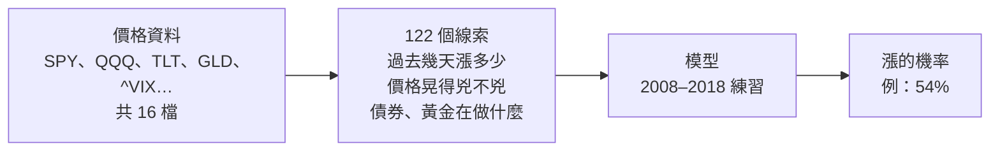
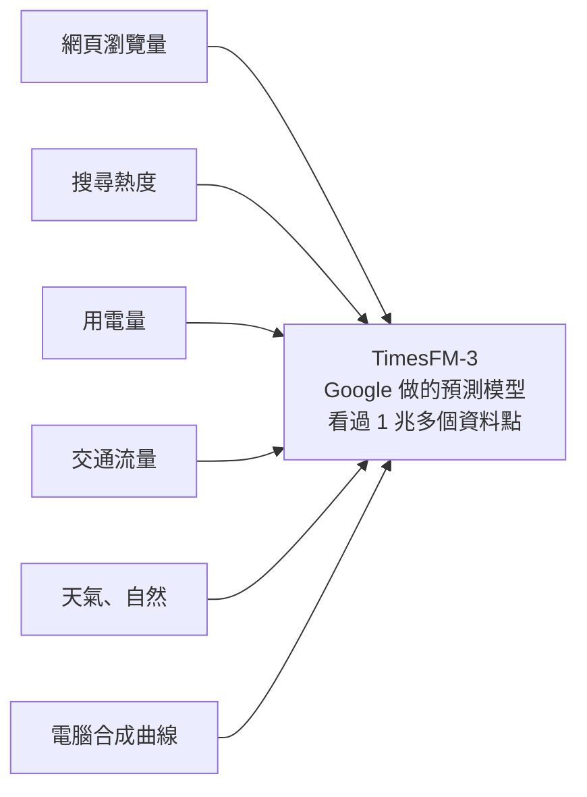

# SPY 漲跌圖解

我們的期末專題在猜什麼？TimesFM-3 又是怎麼猜的？

> 顏色照台灣習慣：紅色是漲，綠色是跌。

## 1. 我們在猜什麼？

```
SPY
                                  ↗  漲？
         /\    /\  /\___  ●
   /\___/  \__/  \/       今天
                                  ↘  跌？
```

SPY 是一籃子美國大公司的股票。專題想猜：**明天**（或**下週**）收盤時，價格會比隔天早上開盤時高嗎？

- 猜明天：`Close[t+1] > Open[t+1]`
- 猜下週：`Close[t+5] > Open[t+1]`

## 2. 原本怎麼猜？找線索，讓模型練習



從 16 檔 ETF 和恐慌指數 VIX 的價格，算出 122 個線索。模型先用 2008–2018 年練習，再去猜 2019–2025 年。

## 3. 專題真正想問：市場會變，要不要一直重學？

```
             練習期 2008–2018          │  考試期 2019–2025
                                       │
只學一次                               ●───────────────────
一直重學                               ●──●──●──●──●──●──●
                                       │
2008 ──────────────────────────────── 2019 ─────────────── 2025
```

市場的脾氣會變。所以專題比較兩種學生：**只學一次**的，和每隔一陣子就用最新資料**重學**的。

結果：一直重學沒有比較準。SPY 的短期漲跌，幾乎跟丟銅板一樣難猜。

## 4. TimesFM-3 是誰？



它是 Google 做的大模型，專門看曲線、猜曲線。它已經讀過超大量的各種曲線，我們**沒有**再用股市資料訓練它，直接拿來用。這叫「零樣本」（zero-shot）。

## 5. TimesFM-3 怎麼猜？

```
                       今天        TimesFM 畫的未來 5 天
                        ┊                    ░░░  ← 上面這塊 = 漲
                        ┊           ░░░░░░░░░░░░
     過去 256 天的 SPY  ┊   ░░░░░░░░░░░░░░░░░░░░
  /\__/\  /\__/\__/\___●┄┄┄┄┄┄┄┄┄┄┄┄┄┄┄┄┄┄┄┄┄┄┄┄  ← 虛線 = 今天的價格
                        ┊   ▒▒▒▒▒▒▒▒▒▒▒▒▒▒▒▒▒▒▒▒
                        ┊             ▒▒▒▒▒▒▒▒▒▒  ← 下面這塊 = 跌
  + 15 檔 ETF 和 VIX 一起看
```

1. 給它過去 256 天的 SPY，再加上 15 檔當參考。
2. 它畫出未來 5 天的**扇形**：中間最可能，越往外越不可能。實際上是 9 條線，代表 10%、20%…90% 的可能。
3. 扇形有多少在今天的價格**上面**，就是「漲的機率」。

## 6. 猜得準嗎？

這個分數叫 **AUC**：0.5 等於丟銅板，1 等於每次都猜對。

```
                      丟銅板
                        ┊
猜明天            TimesFM ●┊ ■ 組內模型
                   0.48   ┊  0.51
猜下週      TimesFM ●     ┊      ■ 組內模型
             0.46         ┊       0.54
        ├────────┼────────┼────────┼────────┤
       0.40     0.45     0.50     0.55     0.60
                                 越往右，越會猜 →
```

| 2019–2025 | TimesFM-3 | 組內模型（只學一次） | 丟銅板 |
|---|---|---|---|
| 猜明天 | 0.48 | 0.51 | 0.50 |
| 猜下週 | 0.46 | 0.54 | 0.50 |

在 2019–2025 年，TimesFM 兩個都落在 0.5 左邊，跟丟銅板差不多（還略差一點），也輸給組內那個只學一次的簡單模型。

可能的原因：它猜得最差的 2020、2022、2025 年，都是先大跌、再很快漲回來。它剛好猜反：市場還在跌的時候，它幾乎每天都說「會漲」；市場已經在漲回來的時候，它反而很少說漲。

它確實有「跌完會彈、漲完會回」的習慣，但我們拆開檢查後發現，這不是它考差的主因。這個習慣在下跌時讓它喊漲（猜錯），在反彈時也讓它喊漲（猜對），一年下來剛好打平。真正讓它在反彈時不喊漲的，是預測裡的另一部分。2025 年查到了一部分原因：它內建一個步驟，會把過去一年畫成一條直線再往前延伸，大跌之後這條線在反彈期間一直把預測往下拉。2020 和 2022 年那部分到底在看什麼，查不出來。

## 7. 是最近兩年害它不準的嗎？

不是。把最近兩年（2024–2025）拿掉，它還是沒有贏過丟銅板。真正的分水嶺在 **2019 年**：在那之前看起來有一點用，之後就沒有了。

```
猜下週的 AUC（0.5 = 丟銅板）

2013–2018  ████████████████████████████▍ 0.55   ← 拿來挑設定的年份，太樂觀
2019–2023  ███████████████████████▊      0.46
2024–2025  ████████████████████████▏     0.46
2026       █████████████████████████▋    0.49
                                    ┊
                                   0.50
```

| 期間 | 猜明天 | 猜下週 | 組內模型（猜下週） |
|---|---|---|---|
| 2013–2018（拿來挑設定的年份） | 0.50 | **0.55** | 無資料 |
| 2019–2023（拿掉最近兩年） | 0.49 | 0.46 | 0.56 |
| 2024–2025（最近兩年） | 0.46 | 0.46 | 0.48 |
| 2019–2025（整段考試期） | 0.48 | 0.46 | 0.54 |
| 2026（1–10 月） | 0.51 | 0.49 | 無資料 |

- **猜明天**：拿掉最近兩年只從 0.48 升到 0.49，還是低於 0.5。2024 年特別差（0.42），但不是唯一的問題。
- **猜下週**：拿掉最近兩年反而更差一點。最差的是 2020 年（0.38）和 2022 年（0.39），不是最近兩年。
- **2019 年以前**：猜下週有 0.55，但這太樂觀了。這幾年本來就是拿來從 10 組設定裡挑最好的，挑出來的那組在同一段資料上當然好看。

為什麼以前看起來比較好？我們不知道（沒有證明）。能確定的只有一部分：這幾年被拿來挑設定，本來就會偏好看。市場的規律會變，以前有效的方法之後不一定有效，這正好是專題的主題。

這也看不出資料洩漏：如果 TimesFM 預訓練時看過 SPY 的歷史，2019–2023 應該會好得不合理，實際上卻很差。

> 注意：這個拆期間的分析是看過考試期結果之後才做的，事先沒有登記，只能當探索性分析，不能當成「TimesFM 在某段期間有效」的證據。數字見 `timesfm3_experiment/results/timesfm_exploratory_subperiods.csv`。

## 一句話

股市的短期漲跌很難猜，就算是 Google 的大模型，直接拿來用也一樣猜不準。

---

數字來自專題 2019–2025 測試期（明天 1,759 天、下週 1,755 天）。模型是 `google/timesfm-3.0-pytorch`，零樣本，設定事先登記後只跑一次。詳細結果見 `timesfm3_experiment/results/timesfm_test_*.csv` 和 `timesfm3_experiment/timesfm_preregistration.md`。
